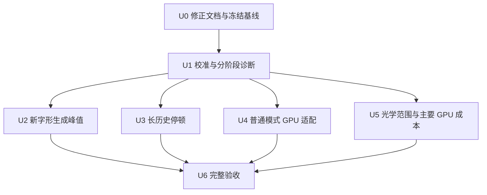

# Flow 稳定 60 FPS：证据校正与后续执行方案

## 1. 授权、目标与当前结论

用户已要求修正两组性能分析，按当前代码和实测结果形成执行方案并开始执行。本方案延续已批准的「保留场景、细分失效、保守光学范围」架构；在现有工作空间由主线程实施。

- **R1：稳定 60 FPS。** 普通入口和显式候选分别验收；回调频率与实际呈现分开，长历史秒级停顿必须解决。
- **R2：画质保持。** 字体、DPR、像素预算、原模糊规格、色散采样、曲面、水膜与焦散方程保持；以冻结基线的局部像素和连续动态画面对照。
- **R3：行为保持。** 原入场、逐字显现、暂停/恢复、原生文字与按钮身份、选词、焦点、历史、追加、减少动态效果及 WebGL 恢复保持。
- **R4：水膜默认开启（用户最新决定）。** 用户查看预览后明确要求默认水膜；普通入口现选择 `liquid-live`，显式 `motion=current` 保留对照能力。此前“候选默认关闭”只描述旧版本。
- **R5：证据可追溯。** 同构建、同模式、同字体、同视口、同轨迹比较，保留失败轮次、原始记录及限制。

**当前：结构改造、新行覆盖合成、梯度增量上传、布局通知合并及部分安全绘制范围已实施；稳定 60 FPS 尚未通过。** 原 `current` 路径仍有明显滤镜停顿，未通过画质的实验没有进入产品代码。用户最新要求的默认水膜、长按释义、左滑菜单及逐帧连续滚动已实现，自动检查通过，新增菜单浏览器复验待恢复验证页；见[交互设计](2026-10-23-flow-water-reading-interaction.md)与[本轮验证记录](../qa/2026-10-23-flow-water-reading-and-native-filter.md)。本方案中的待验证与未完成项不构成用户同意延期。

不把水膜降频、模糊量化、降低分辨率、关闭动效、增加「逐行入水」新行为或更换引擎纳入本轮默认实现。它们不满足现有等价性前提。用户随后明确要求 commit、push；本轮相关改动验证后提交并推送当前分支，不发布。

## 2. 本轮开始前的事实基线与模式边界

事实来源：当前工作区源码、`docs/qa/2026-10-23-flow-retained-render.md`、`.tmp/flow-retained-render-20261023/` 中的原始 JSON/脚本/冻结基线。开始本轮前，9 个核心源文件与最终测量哈希一致。历史原生产版本与中间构建的数据继续标明版本，不与最终版本混用。

下表记录开始本轮前的状态；本轮最终构建 `3f42a54778e65474` 的结果见[执行记录](../qa/2026-10-23-flow-60fps-execution.md)及第 5 节。结束控制页约 29.20 FPS；本轮未修改电源设置，但开始和结束观察到的接电低电量模式不同，切换时刻未知，因此耗时对照有混杂因素。

| 项目 | 已知事实 | 状态 |
| --- | --- | --- |
| 可见范围索引与保留对象 | 9630 单元场景最多可见 155，帧内索引访问 323；全量布局重测仍存在 | 已实施；布局成本待定位 |
| 字体/交互失效分离 | 悬停不递增字体版本；稳定测量字体版本保持 1 | 已实施 |
| 容量与有效范围分离 | 有效源范围可收缩，容量可保留，清理包含旧新范围 | 已实施；后续光学范围未完成 |
| 缓存回收与资源所有权 | GPU 图集最多 32 MiB，局部回收；CPU 字形预算 16 MiB；GPU 成功路径旧 Canvas 为 4 字节 | 已实施 |
| 最终短内容候选诊断 | 桌面静置/首次快滚/重复快滚约 29.60/29.70/29.50 FPS；CPU P95 1.4/12.3/3.9ms | 60 FPS 未通过 |
| 手机模拟候选诊断 | 对应约 29.45/29.40/29.05 FPS；CPU P95 1.7/19.3/6.9ms | 60 FPS 未通过；非真机结论 |
| 绘制路径 | 上述桌面 891 帧、手机 884 帧均为 `cached`，不是普通入口 Canvas 路径 | 已核实 |
| 控制页 | 可见、有焦点，8 秒 239 回调，29.69 FPS；历史同类控制也曾恢复约 60Hz | 当轮未通过校准；具体原因未知 |
| 长历史 | 最终有效轮次快滚约 3.42/5.83/3.52 FPS，存在约 1 秒间隔 | 必须继续定位与修复 |
| GPU | 中间构建整段静置 6.565–18.786ms、滚动 9.105–15.806ms；分通道结果不可靠 | 不能确定最贵内核 |
| 既有质量与自动检查 | 416 项测试；最终康熙字体 13 组像素对照最大差 1/255；已列交互检查通过 | 只对既有版本成立 |

| 模式 | 字形后端 | 持续水膜 | 本轮责任 |
| --- | --- | --- | --- |
| 普通 `current` | Canvas 源文字 + WebGL 光学 | 无候选水膜 | 独立测量、评估等价 GPU 缓存适配 |
| 显式 `liquid-live` 候选 | 正常为 GPU 字形缓存，异常回退 | 按原动态持续更新 | 处理缓存未命中峰值、必要绘制范围及长停顿 |
| 减少动态效果 / 上下文丢失 | 原生文字回退 | 按原行为 | 保持可读、焦点与恢复 |

## 3. 已确定的架构与关键接口

| 模块 | 本轮职责与契约 |
| --- | --- |
| `FlowStream.tsx` | 保留 DOM 为布局和交互来源。可见索引与活动状态继续复用；诊断区分布局重测、场景更新、绘制提交；只在显式探针启用时记时。 |
| `stream-frame-plan.ts` | 继续区分字体、布局、交互和动效。滚动改变离焦与透明度，必须更新真正受影响的合成结果；不将滚动一律视为仅位移。 |
| `stream-glyph-cache.ts` | 保持行/基础字形身份和 RGBA 覆盖掩码契约；优化新单元生成与上传，维持缓存预算、可见单元保护和回退。 |
| `stream-glass.ts` | 管理普通/候选字形后端、有效源范围与生命周期；后端优化不得打开候选效果。 |
| `renderer.js` / 曲面、水膜模块 | 保持材质方程与时序；只在保守范围与中性色可证明正确时跳过工作。GPU 计时异步、限于诊断。 |
| 本轮诊断脚本与 QA | 在独立本地测试内容上运行；阻断模型/搜索/注释请求；逐帧记录焦点/可见性、模式、后端、构建与测量范围。 |

滚动时基础字形可以复用，但位置、模糊、透明度、前景归属变化后的中间图像不能直接复用。`capacity` 保留不等于允许扩大后的像素范围永久执行。最终画布裁切还必须正确处理本帧未绘区域。

## 4. 执行顺序

图表示依赖；执行由主线程顺序推进。环境校准失败不妨碍独立的源码修正、同环境 A/B 成本比较和画质验证，但稳定 60 FPS 仍保持未通过。

### U0 — 文档校正与冻结基线

- [x] 修正两组共 6 份文档，取消过时待办和未经验证的收益、工期、硬限帧结论。
- [x] 保存本轮开始时源码、原报告、生成文件及哈希，建立单独证据目录。

要求：R4、R5。文件：两组原报告、本方案和执行 QA。无产品行为变更；核对链接、来源、完成状态与数字一致。

### U1 — 校准、模式矩阵与分阶段诊断

- [x] 在 Ego Lite 本轮专用执行空间内记录持续变化控制画面；区分 `current` 与 `liquid-live` 的短内容、首次/重复快滚及长历史。开始和结束校准均未通过。
- [x] 在已有可选探针中增加布局重测次数/耗时、场景更新与文字绘制阶段耗时、缓存新单元与上传统计。正常路径不做阶段计时或诊断读回。
- [ ] 获取归属明确的帧调度/呈现证据；定位秒级间隔发生在哪一段。只记录本轮页面，不采集无关页面内容。

已有普通模式目标页面 trace：BeginFrame 最长间隔约 1017ms，单次主帧最长约 25.8ms；尚不能完成 GPU、合成与实际呈现的关联归因。

要求：R1、R5。依赖 U0。文件：`FlowStream.tsx`、`stream-glass.ts`、`stream-glyph-cache.ts`、本轮测量脚本；测试：`tests/unit/flow-stream.test.tsx`、`flow-stream-glass.test.ts`、`flow-glyph-cache.test.ts`。

验收：探针关闭不影响行为；开关后的图像一致；每份记录包含构建、模式、后端、字体、视口、轨迹、焦点与可见性。控制失败时仍报告真实诊断，不能宣布恒定硬上限或环境无能为力。其他浏览器仅作额外定位对照，不能悄悄替换已约定的 Ego 验收。

### U2 — 降低新字形进入时的同步峰值

- [x] 以 Canvas 原生预乘合成生成覆盖掩码，替代行缓存未命中时两次整块 `getImageData` 和逐像素循环；保持 RG 字形、B 下划线、A 不透明的原纹理契约。
- [x] 对首次生成阶段加入按需 CPU 计时；明确嵌套时间不可相加，上传调用时间不代表 GPU 完成时间。
- [x] 仅上传实际改变的接触梯度；验证静置相位、滚动、显现、焦点拆行和恢复的失效条件。
- [ ] 更长轨迹、稳定电源条件及不同设备验证剩余峰值。若仍超预算，再按邻近顺序设计有界预备队列；本轮未加入队列。

要求：R1、R2、R3。依赖 U1。文件：`stream-glyph-cache.ts`，必要时 `FlowStream.tsx`；测试：`flow-glyph-cache.test.ts`、`flow-stream-gpu-fallback.test.ts` 与固定字体浏览器对照。

验收：新旧掩码及最终画面对照覆盖文字/标点、下划线交叠、分数像素、颜色、两种密度和显现；内存上限不增加；首次快滚峰值实际下降且重复快滚不回退。若合成等价性不成立，撤销该实验并记录，不放宽画质门槛。

### U3 — 长历史布局、绘制与帧调度

- [x] 记录 `remeasure` 的触发原因、次数和耗时；区分首次布局、内容、字体和视口变化与纯滚动。
- [x] 合并同批字体/尺寸通知，忽略尺寸相同的通知；保持同步需要的首次/恢复布局及原生按钮身份。短内容本轮布局次数由 6 减至 4。
- [ ] 若瓶颈来自浏览器离屏绘制，设计按段落的绘制隔离和保守尺寸缓存；先证明跳转、选择、焦点、追加和滚动锚点正确，再应用。全量几何读取不能抵消离屏隔离。
- [ ] 对约 1 秒间隔追踪主线程、合成与 GPU 的关联，避免仅凭一次 `Layout` 或 `Paint` 事件定责。

本轮新旧候选长历史均未复现旧秒级间隔，不能认定已修复；普通模式仍约 3–5 回调 FPS。最终长历史一次字体布局约 220ms，仍需优化。

要求：R1、R3、R5。依赖 U1。文件：`FlowStream.tsx`、`stream-scene.ts`、必要时 `flow.module.css`；测试：`flow-stream.test.tsx`、`flow-stream-scene.test.ts`、`flow-reading-menu.test.tsx` 及真实浏览器长历史检查。

验收：可见遍历继续有界；减少无效布局工作；180 段长历史、反向快滚、跨段焦点、追加和恢复无阅读器造成的秒级停顿。未确定原因时此单元保持未完成。

### U4 — 普通模式等价 GPU 字形适配

- [x] 单独建立 `current` 的 Canvas 基线，不把候选已有 GPU 测量当作普通模式收益。
- [ ] 检查普通模式完整模糊规格（手机最大 9px，而当前 GPU 前景支持至 8px）、颜色、边缘和原生文字移交；补齐能力后才考虑解除后端与液态效果的耦合。
- [x] GPU 适配、行合并、范围收缩、软件 Canvas 和局部裁切实验均未通过画质或性能门槛，已记录并保留普通模式原路径；本项仍未完成。

要求：R1–R4。依赖 U1。文件：`stream-glass.ts`、`stream-glyph-cache.ts`；测试：`flow-stream-glass.test.ts`、`flow-glyph-cache.test.ts`、`flow-motion-candidate.test.tsx`，普通/候选切换固定画面对照。

验收：普通模式同等视觉、无新水膜、默认开关不变；手机边缘不频繁回退；缓存错误/超预算/上下文恢复正常；收益由普通模式同条件比较给出。

#### U4 后续：原生滤镜范围（继续实施）

用户先要求解决普通模式滤镜停顿并展示实际效果，验证通过后 commit、push。之后查看预览时改为默认水膜、按需释义；此处仍保留原 `current` 对照路径的优化责任。沿用现有 Canvas 文字源与 WebGL 光学接口，先消除原生滤镜不必要的全画布绘制。

- `stream-frame-plan.ts` 增加物理像素范围计算：字形真实边界加原模糊支持范围。小于等于 4px 且字形栅格相位明确时可使用局部范围；歧义时只收缩右、下边界。7px / 9px 饱和模糊分别保留原 7 / 18px 采样周期；其余大模糊保持全范围，不改变 sigma。
- `StreamGlass.paintTextRuns` 将已有密度传给原生文字绘制；只对单位缩放、未裁过源图的原生路径使用该范围。任意缩放及液态缓存回退保持原绘制，以免改变字形栅格的子像素相位。没有新增图集、画质档位或动效开关。
- 正式实现已通过 400 个固定/动态输入的逐像素一致检查，涵盖实际字体、投影曲线、9px 模糊、焦点、逐字、重叠、栅格边界与非单位缩放回退。改动前桌面快滚约 5–6FPS，保守优化后约 12–22FPS，仍不能宣布滤镜停顿或稳定 60FPS 已解决。其他大模糊裁切和低延迟 Canvas 实验未采用。
- 验收保持原标准：原字体、原画布密度、原材质和所有显现保留；完整页首次/重复/反向快滚、入场、逐字、特效显现和恢复通过；控制及实际呈现达到标准后才能宣布稳定 60 FPS。临时诊断提速不作为最终达标。

原生范围同时受栅格原点及降采样中心影响，单独保持区域中心仍不足以保证动态等价。失败克隆和新证据保留在 `.tmp/flow-current-filter-20261023/`。原实现参考：[Chromium 原生滤镜分层](https://github.com/chromium/chromium/blob/main/third_party/blink/renderer/modules/canvas/canvas2d/canvas_2d_recorder_context.h)、[Skia 模糊引擎](https://github.com/google/skia/blob/main/src/core/SkBlurEngine.h)。

### U5 — 保守光学范围和主要 GPU 成本

- [x] 重测最终构建的整段 GPU 成本，10 个异步查询未 disjoint 且与墙钟自洽；保留插桩首帧 CPU 54.2ms 峰值。
- [ ] 取得可靠分通道归因及交替重复收益；已有分通道超时，不能按估算挑内核。
- [x] 分开源图有效宽度与容量映射，用于源绘制及水膜横向 scissor；水膜只绘制两侧折叠带，保留一像素保护边界并每帧清理为精确中性色。
- [ ] 对透射、湿边、运输和最终曲面继续传播保守影响范围；无法证明安全的区域仍完整绘制。
- [x] 已落地范围通过固定画面及连续动态对照，没有新增裁切、残影或通道差异。
- [ ] 如主耗时来自特定内核，复用可证明相同的核权重/公共计算，保留采样位置和数量；记录不获益或不等价的实验。

要求：R1、R2、R5。依赖 U1。文件：`stream-frame-plan.ts`、`stream-glass.ts`、`stream-glyph-cache.ts`、`miniprogram/flow/renderer.js`；测试：`flow-render-passes.test.ts`、`flow-stream-glass.test.ts`、`flow-liquid-contact.test.ts` 及像素/动态画面对照。

验收：整段 GPU 与完整页获得可重复收益；没有裁切、残影、亮度或连通性变化。不能预先承诺减少 50–90% 采样或达到 60 FPS。

### U6 — 回归与正式验收

- [x] 全部 Flow 单测（422 项）、小程序共享逻辑（124 项）、应用/脚本类型检查、lint、生产构建通过；清理生成文件后类型检查再次通过。
- [x] 最终固定画面 16 组及连续动态 36 帧逐像素一致；最终浏览器候选开关、身份/暂停保持、焦点、上下文恢复、减少动态效果、字体和溢出检查通过。
- [ ] 完成正式完整页动态入场、逐字、反向滚动、追加和历史组合的长时浏览器回归。本轮历史/追加由单测覆盖，不把旧浏览器记录算作本轮实测。
- [ ] 校准通过后，每个稳态场景连续 30 秒、5 轮，报告实际呈现、回调频率、P50/P95/P99、错过周期比例及最长停顿，保留异常轮次。
- [x] 桌面 1440×900 与手机模拟 390×844 分开报告。
- [ ] 真机手机验收；本轮未运行。

要求：R1–R5。依赖 U2–U5 的已落地修改。沿用原方案的 60Hz 标准：错过呈现周期 <1%，无阅读器导致的持续掉速及 >50ms 停顿；实际呈现不足时不得以 CPU/GPU 小于预算替代。初始化、字体加载、恢复另报。新的画质差异不可用黑底平均值掩盖，也不因性能结果而放宽门槛。

## 5. 本轮证据与执行状态

2026-10-24 补充：默认水膜、连续慢滚、长按释义及左滑统一菜单的最终功能实测通过；前台控制页约 29.56 FPS，稳定 60 FPS 仍未通过。用户明确决定“先提交并同步已验证功能，60 FPS 继续迭代”。此决定仅调整本轮交付顺序，不将 U1–U6 的未完成性能要求记为完成。结果见[功能验证记录](../qa/2026-10-23-flow-water-reading-and-native-filter.md)。公网同步保留线上已有 Next.js 15.5.28 安全补丁。

新证据保存于 `.tmp/flow-60fps-execution-20261023/`；旧证据不覆盖。该目录被 Git 忽略，交给异机审查者时需单独提供。版本、源文件哈希、测量摘要及原始证据哈希另保存为[可随代码审阅的证据索引](../qa/evidence/2026-10-23-flow-60fps-execution.json)。

| 单元 | 本轮状态 | 证据与仍需完成的工作 |
| --- | --- | --- |
| U0 | 已完成 | 6 份修订文档；75 个冻结文件，baseline-hashes.json |
| U1 | 部分完成 | 模式矩阵及探针已实施；控制校准和实际呈现归属未通过 |
| U2 | 实现及画质已通过，收益待严格复测 | 合成与增量上传已落地；首次快滚 CPU 下降仅为当轮观察，更长轨迹、稳定电源及跨设备峰值待验证 |
| U3 | 部分完成，根因未解决 | 布局通知合并及目标页面 trace；普通模式停顿、字体布局峰值和旧候选异常仍需处理 |
| U4 | 未完成 | 多个实验未通过质量或性能；普通模式继续保留原路径 |
| U5 | 部分完成 | 有效宽度及水膜折叠带已验证；透射/最终曲面范围、主要内核及可重复收益未完成 |
| U6 | 未通过 | 自动检查及限定画面/行为回归通过；正式呈现、长时组合和真机验收未通过 |

完整结果见[执行记录](../qa/2026-10-23-flow-60fps-execution.md)。**下一步优先处理普通模式原生滤镜的范围与等价性**，冻结多词行/模糊/焦点基线定位局部裁切的采样差异，并关联 Canvas 提交与合成间隔；通过同等画质后再接入后端。继续保留 60 FPS 和全部视觉要求。技术未知由实施中的测量解决；只有目标、范围、视觉要求或授权发生实质变化才重新提出设计问题。
