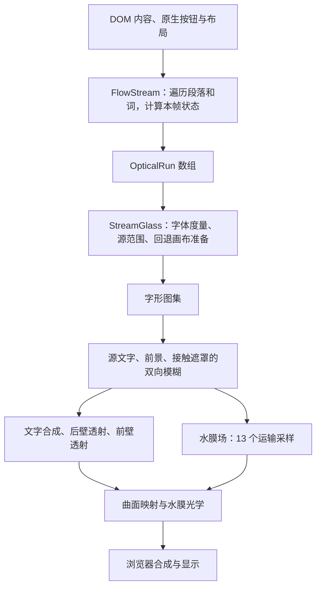

# 阅读器稳定 60 FPS：渲染架构研究

日期：2026-10-23。状态：**方案已获批准，结构修正已实施；稳定 60 FPS 尚未验收通过。** 实施、画质对照、性能诊断和未通过项见[本轮实现与验收记录](../qa/2026-10-23-flow-retained-render.md)。

阅读说明：第 2–5 节记录实施前的证据和源码快照，代码行号指向当时版本；第 6–8 节保留获批设计及验收要求，不代表其中所有步骤已经完成。实际接口与落地边界以验收记录和当前源码为准。

依据：当前仓库源码、已保存的三轮动效 QA 记录、本轮 Ego Lite 控制实验，以及 MDN / Chromium 官方渲染资料。此前 QA 指向的 `/tmp/infidao-motion-60fps-20261023/` 本轮已不可读；历史数字按 QA 记录引用，没有当作本轮重新测量的结果。

## 1. 建议

采用**按行保留场景、按变化类型更新、按光学影响范围绘制**的候选渲染架构，继续使用现有 WebGL 材质。

当前 GPU 字形缓存有明确价值：减少了重复栅格化与上传。但它接在原来“整批可见文字发生变化”的接口后面，滚动、悬停、字体变化仍会触发范围过大的工作。下一轮应先解决失效粒度与资源边界，再用分阶段测量决定 GPU 优化落点。

整体目标继续是稳定 60 FPS、原入场和逐字显现、原画质、候选默认关闭。不能用更少的色散采样、更低分辨率、停掉水膜动态或延后必要验收来替代目标。

## 2. 已知证据与未知项

| 证据 | 可以得出的结论 | 不能得出的结论 |
| --- | --- | --- |
| 上轮隔离绘制器：文字绘制 CPU 均值从 12.35 ms 降至 1.75–4.60 ms | 字形缓存减少了这段 CPU 工作 | 整页已具备稳定 60 FPS |
| 上轮完整页快滚约 21–28 FPS；简单画布约 29.6 FPS | 环境节奏与应用开销同时需要调查 | 所有慢帧都由环境造成 |
| 更早的同一原生产版在应用内浏览器静置三轮约 60 FPS | 21 FPS 不是该版本静置性能的恒定值 | 最终 GPU 版本在快滚时已达到 60 FPS |
| 本轮没有运行阅读器的控制页仍出现长间隔 | 长间隔可以在阅读器之外发生 | Ego Lite 恒定锁定 30 FPS，或已找到环境原因 |

历史来源：[GPU 缓存与交互 QA](../qa/2026-10-23-flow-gpu-cache-and-controls.md)、[绘制节奏调查](../qa/2026-10-23-flow-motion-followup.md)、[初始候选 QA](../qa/2026-10-23-flow-motion-candidate.md)。

### 本轮控制实验

Ego Lite，Chrome 154，ANGLE Metal / Apple M4；1450×713，DPR 2。新建空白页面，仅让可见的 160×160 Canvas 每个 RAF 交替绘制黑白色。点击画布后连续两轮，每轮至少 4 秒，页面均报告可见、获得焦点。

| 轮次 | 绘制回调 FPS | 间隔中位数 | P95 间隔 | 最大间隔 |
| --- | ---: | ---: | ---: | ---: |
| 1 | 21.91 | 33.4 ms | 66.6 ms | 1016.1 ms |
| 2 | 25.39 | 33.4 ms | 67.6 ms | 165.8 ms |

原始数据：`.tmp/flow-render-architecture-research/ego-control.json`。初次未获焦点的试跑不纳入此表。实验页已关闭；没有修改系统或浏览器设置，没有请求模型。

这里统计的是绘制回调间隔，**不是屏幕实际呈现帧的独立证据**。这组结果说明当前测量条件不足以验收 60 FPS；仍可用来研究 CPU、资源使用及画质，不能据此宣称应用性能问题已解决。RAF 受浏览器绘制节奏与页面状态影响，回调频率本身也不能覆盖整个呈现链路。[MDN：requestAnimationFrame](https://developer.mozilla.org/en-US/docs/Web/API/Window/requestAnimationFrame)

## 3. 当前绘制链路



- 只改变水膜相位时，已有实现会复用基础文字和玻璃合成。这项优化已经存在。
- 滚动改变 `scrollTop`，`FlowStream` 构造新的 `runs`；`StreamGlass` 以数组身份判断 `sourceChanged`，随后更新文字源并执行三阶段基础合成。
- 字形图集省去了大部分 `fillText`，后续模糊、纹理读写、两次玻璃透射、水膜与最终合成仍然存在。
- 浏览器网页路径由 `FlowStream` 的 RAF 直接调用 `draw()`；没有进入 `WheelRenderer.start()` 的 32 ms 节流。修改那个默认值不能解决当前网页问题。
- 帧内主循环不是通过 React 状态逐帧重渲染；需要检查的是该循环中的遍历、DOM 操作、驱动提交及其下游开销。

代码入口：`src/components/flow/FlowStream.tsx:127`、`src/lib/flow-browser/stream-glass.ts:320`、`src/lib/flow-browser/stream-glyph-cache.ts:373`、`miniprogram/flow/renderer.js:920`。

## 4. 已确认的结构问题

以下是源码可以确认的行为；它们各自占多少毫秒，仍需测量。

### 4.1 高亮、布局、字体共用一个失效编号

`bindBendInteraction` 在悬停目标改变时调用失效回调；`FlowStream` 在该回调里增加 `measurement`，并把它作为 `fontRevision` 传给绘制器。`StreamGlyphCache` 发现这个编号改变，会清空图集。

结果：仅改变折弯文字的悬停高亮，也会沿着“字体改变”的路径重建缓存。追加内容引发的重新测量也存在同样的全量失效。

证据：`src/lib/flow-browser/bend.ts:34` → `src/components/flow/FlowStream.tsx:357` → `src/lib/flow-browser/stream-glass.ts:358` → `src/lib/flow-browser/stream-glyph-cache.ts:378`。

**设计要求：**字体、布局、字形内容、悬停与显现分别失效。高亮由独立绘制状态表达，避免把下划线烘进基础字形缓存身份。

### 4.2 缓存了图像，但每帧仍重建整批绘制描述

`sceneKey` 包含滚动位置；滚动后遍历整个 `words`，创建新的 `OpticalRun` 和命中数组，随后重新分行、建立键、打包顶点。仅水膜变化时虽然能复用 `runs`，仍会遍历 `parts` 并拼接全部段落的状态键。

`connectedRecords` / `streamEntries` 保留连续路径。当前可见性判断发生在遍历内，所以每帧 CPU 工作会受已加载内容长度影响，而不只受屏幕上文字数量影响。

证据：`FlowStream.tsx:135`、`:169`、`:184`，`stream-glyph-cache.ts:304`、`:339`，`continuity.ts:12`。

**设计要求：**保留内容坐标中的行与字形记录；用行索引查询可见区域，逐帧只更新可见行、仍在入场/显现的行，以及刚离开区域的行。DOM 中的文本与原生按钮继续保留，渲染索引不承担删除阅读历史的职责。

### 4.3 分配容量与本帧绘制范围混在一起

`fitSource()` 为避免反复分配，让裁切左右边界只增不减。某次入场或宽文字扩大了范围后，后续较窄场景仍使用扩大后的窗口。

证据：`stream-glass.ts:172`。

**设计要求：**分别记录 `capacity`、`activeRect` 与 `dirtyRects`。容量可以保留；本帧清理、绘制和采样的有效范围应随内容收缩。旧位置与新位置都必须纳入清理，防止残影。

### 4.4 GPU 路径仍承担部分旧 Canvas 准备

尝试 GPU 字形缓存之前，`StreamGlass.draw()` 已调整旧源画布尺寸，并在源变化时清空源画布和前景画布。GPU 缓存返回成功后，这些画布不参与该帧结果。

证据：`stream-glass.ts:366` 至 `:394`。

**设计要求：**度量和源边界作为独立数据；旧 Canvas 绘制资源按回退需求创建和更新。保留错误回退时的原生可读状态。

### 4.5 稳态工作量、峰值分配与缓存满后的行为缺少统一预算

当前最多两个 2048×2048 RGBA8 图集，仅其纹理就是 **32 MiB**；最大模糊暂存纹理再占 **16 MiB**。按 1789×1118 输出尺寸，现有两张 0.75 倍透射目标、全尺寸合成目标和 0.66 倍水膜目标，颜色纹理合计约 **19.54 MiB**，尚不含深度、文字源、前景、接触、显现、Canvas backing 和浏览器自身资源。

这不是实际显存占用测量，也不代表已经超出设备能力；它说明“多缓存一些”存在成本。图集满时目前会整体清空后重试，可能产生突发栅格化；尚无证据证明它导致了已观察到的长帧。

**设计要求：**按字节记账，保留可见行及必要预取区域，分批回收失效单元，记录命中率、清空次数、上传字节与分配次数。稳定滚动时不应随历史长度持续增长；真实字体或尺寸变化产生的必要上传需单独统计。

## 5. 为什么不能只数 GPU 通道，或直接换引擎

### 5.1 需要区分工作量、带宽与调度

在 1789×1118 下，最终画布约 200 万像素。

- 前景高斯模糊的横向与纵向循环上限各为 49 个位置；接触遮罩各为 31 个位置。实际执行受 sigma 和行区域影响，不能把上限直接乘全屏当成实测耗时。
- 每次玻璃透射保留 8 组 RGB，即最多 24 次源纹理采样；前后壁分别执行，实际覆盖区域、分辨率及提前返回不同。
- 水膜场有 13 个运输采样；最终水膜着色还有梯度、折射与焦散计算。

CPU 调用很快，可能只是命令提交很快。浏览器主线程、GPU 与合成存在流水执行，不能把所有阶段的 CPU 时长简单相加，也不能把每个 draw 的 GPU 探针结果直接求和后换算 FPS。[Chromium：RenderingNG architecture](https://developer.chrome.com/docs/chromium/renderingng-architecture)

### 5.2 两次玻璃透射有真实依赖

后壁结果会被前壁取样。若把后壁计算直接内联到每个前壁采样，可能把两段各 24 次采样的流水变成类似 `24 × 24` 的嵌套工作，还会改变中间纹理过滤行为。

因此保留两次原材质透射；优化它们的输入更新、覆盖区域、资源提交与公共计算。通道数下降本身不算收益证据。

### 5.3 全量预计算光线路径也不免费

若给约 200 万像素、每个像素 24 个采样点保存两个 float32 UV，仅一套映射就约 **366 MiB**，还没有权重和第二次透射。不能把“材质几何不变”直接推成“缓存所有光线更快”。

现有曲面已经使用按输出行的低维查找表。后续优先复用可证明相同的低维数据、内核权重及公共中间量；整套光线映射需单独证明内存和带宽收益。

## 6. 推荐架构

### 6.1 职责与接口

| 模块 | 责任 | 关键边界 |
| --- | --- | --- |
| `FlowStream.tsx` | 原生内容、输入、DOM 测量、焦点和命中 | DOM 是排版与交互来源；测量结果按版本提交 |
| `stream-scene.ts`（拟新增） | 持久化行、内容坐标、可见行索引、入场与显现状态引用 | 稳定 `rowId` / `glyphId`；布局数据与逐帧参数分开 |
| `stream-frame-plan.ts`（拟新增） | 失效依赖、所需通道、有效区域与清理范围 | 输入变化原因，输出明确的绘制计划 |
| `stream-glyph-cache.ts` | 原字体栅格图集、句柄、回收及上传 | 字形身份由文字、字体版本、字距、密度等决定；悬停不清图集 |
| `stream-glass.ts` | 生命周期、GPU 路径和原 Canvas 回退 | 统一资源所有权；回退资源按需准备 |
| `renderer.js` 及原曲面/水膜模块 | 执行既有材质通道 | 保持原方程、采样、精度和共享命中几何；显式接收本帧资源与区域 |

概念接口如下，尚未落入产品代码：

```ts
setLayout(snapshot: {
  layoutRevision: number;
  fontRevision: number;
  rasterScale: number;
  rows: readonly LayoutRow[]; // 内容坐标、原字体、文字与稳定身份
}): void;

renderFrame(state: {
  time: number;
  scrollTop: number;
  surfacePhase: number;
  entrance: ReadonlyMap<RowId, number>;
  ink: ReadonlyMap<RowId, InkState>;
  focus: ReadonlySet<GlyphId>;
}): void;

invalidate(reason: InvalidationReason, rows?: readonly RowId[]): void;
```

这些接口是内部契约；输入中的 DOM 引用留在 `FlowStream`，绘制层只接收布局与动效数据。一次提交使用同一个滚动、曲面、相位和命中快照，避免视觉与点击位置分属不同帧。

### 6.2 更新矩阵

| 变化 | 基础字形栅格 | 行参数/显现 | 基础玻璃合成 | 接触/水膜与最终输出 |
| --- | --- | --- | --- | --- |
| 滚动、已有行进出视口 | 已缓存行复用；缺失行补充 | 更新可见行与移出行 | 更新受影响部分 | 更新 |
| 入场位移 | 复用 | 更新活动行 | 更新受影响部分 | 更新 |
| 逐字显现进度 | 复用 | 更新活动字符与湿边 | 更新受影响部分 | 新显现笔画按原规则参与接触 |
| 悬停/焦点 | 复用 | 更新高亮及原有聚焦行为 | 更新受影响部分 | 按依赖更新 |
| 仅水膜相位 | 复用 | 原入场/显现状态不变 | 复用已有合成 | 更新接触、水膜及输出 |
| 新增内容 | 补充缺失字形 | 更新受影响行布局 | 更新相关范围 | 更新相关范围 |
| 字体、字号、字距、密度 | 对真实受影响字形失效 | 重测相关布局 | 失效 | 失效 |
| 减少动态效果、上下文丢失 | 使用已有原生回退 | 保留状态 | 恢复时重建 | 恢复时重建 |

滚动确实会改变离焦与透明度，不能声称它只需要一个位移 uniform，也不能复用不再正确的玻璃结果。该方案减少可复用数据的重建，并明确剩下的必要工作。

### 6.3 限制光学工作范围的正确方式

源范围来自字形、原模糊半径、下划线和湿边。后续范围还必须包含两次透射、曲面映射、水膜运输、梯度与采样过滤的影响。

对每个通道定义保守的影响范围传播：先把输入区域扩展到该通道可能读取的全部邻域，再映射到输出；无法证明的部分保留完整绘制。不能直接用文字矩形裁掉外侧色散。旧、新位置的并集用于清理；每个被跳过区域都必须保持原来的中性色或透明值。

首次实现先在调试视图画出这些范围，逐像素检查最外侧光晕和水膜边界。区域优化必须先证明不会裁掉原效果，再评估它实际减少了多少绘制像素。

### 6.4 GPU 内核优化放在测量之后

如果模糊占主要成本，优先研究原 sigma 对应的归一化核复用、恒定权重公共计算及批量顶点提交；保持核半径和采样位置。线性采样合并仅在权重、纹理边界与调制函数满足等价条件时采用，不能直接套在包含逐字遮罩和接触权重的循环上。

如果玻璃或水膜占主要成本，先缩小经证明无影响的区域，再检查重复中间量。当前已存在的噪声散列缓存、曲面行查找表和相位帧合成复用继续使用。

资源侧避免热路径同步查询、频繁纹理重分配与混杂 DOM 纹理上传。这些方向有通用依据，但收益必须在本项目测量。[MDN：WebGL best practices](https://developer.mozilla.org/en-US/docs/Web/API/WebGL_API/WebGL_best_practices)

## 7. 方案比较

| 方向 | 能解决什么 | 主要成本与限制 | 判断 |
| --- | --- | --- | --- |
| 继续在当前链路逐点优化 | 个别计算或提交成本 | 粗粒度失效、历史遍历、资源边界仍在 | 适合明确小问题，不足以作为整体方案 |
| **按行保留场景 + 明确失效 + 保守范围绘制** | 重建范围、缓存突发、无关区域开销、长期增长 | 需重构内部输入和资源计划；区域边界要严格证明 | **推荐主线** |
| OffscreenCanvas + Worker | 主线程脚本/提交竞争 | GPU 工作不因换线程消失；DOM、字体、输入快照需要同步 | 主线程测量证实需要时再选 |
| WebGPU 或全新文字/材质引擎 | 可重做数据组织、计算与批处理 | 迁移、能力回退、字体一致性和材质复现成本高 | 现有证据不足以支持直接重写 |

Worker 的作用是隔离执行线程，不能据此推导 GPU 负载下降；这是结合浏览器线程结构与当前绘制任务的判断。[Chromium：线程与合成](https://developer.chrome.com/docs/chromium/renderingng-architecture)

## 8. 实施顺序与决策门槛

### 第一步：让测量能回答“时间花在哪里”

统一固定离线内容、生产构建、视口、实际 backing 尺寸、字体、相位种子和滚动轨迹。记录浏览器版本、可见/焦点状态、控制页节奏。新建诊断入口或探针时由开关启用，不增加正常阅读的逐帧读回。

分别观察：

1. 输入/滚动、主线程脚本、样式和绘制；
2. 图集命中、失效原因、分配次数、上传字节、各通道覆盖像素；
3. GPU 完成情况与浏览器实际呈现、丢帧、部分呈现帧。

GPU timer 若可用，采用异步读取并检查 `GPU_DISJOINT_EXT`；先验证整段计时是否自洽，不能继续使用与墙钟明显冲突的分段求和。正常测速不插入 `gl.finish()` 或逐帧像素读回。[MDN：GPU 计时扩展](https://developer.mozilla.org/en-US/docs/Web/API/EXT_disjoint_timer_query)

使用 Chromium 的 Frames / Main / GPU 记录区分画布更新迟到与滚动仍正常的部分呈现帧。[Chrome DevTools：帧与 GPU 分析](https://developer.chrome.com/docs/devtools/performance/reference)

可做冻结单个阶段的诊断对照，但这会改变下游输入；它只用于定位，不计为可交付方案，也不能把各个差值当作独立成本相加。

### 第二步：完成结构修正

按 6.1 的模块契约实现：细分版本与失效、保留行数据、可见行索引、容量和有效区域分离、回退资源按需准备、明确缓存回收。先保持原 GPU 方程和完整光学绘制范围，以固定输入输出一致作为门槛。

验收缓存行为：已有内容滚动与悬停不发生全图集清空；新内容只补充必要单元；字体变更可正确失效；稳定场景没有持续分配；长内容的帧内遍历随可见/活动行数量变化。

### 第三步：按测量结果压缩主要 GPU 成本

实现经证明安全的影响范围；随后选择实测占比最高的内核。每次实验都与同一冻结基线交替测量，记录失败方案和画质差异。若某项优化只使隔离绘制器变快，完整阅读页不获益，不把它计为 60 FPS 的达成。

### 第四步：正式阅读器验收

以下为建议的测试方案，**不是已经取得的结果**：

- 目标环境先通过持续变化控制画面的 60 Hz 节奏校准。控制不通过时记录环境问题，整页 60 FPS 仍保留为未通过。
- 生产完整页覆盖静置水膜、自动流动、1500 CSS px/s 快滚、入场与显现叠加、反向滚动、追加内容、字体更新及长阅读历史。
- 每个稳态场景建议连续 30 秒、5 轮；报告实际呈现 FPS、P50/P95/P99、错过刷新周期比例与最长停顿，保留异常轮次。初始化、字体加载和恢复另报，不能从所有数据中悄悄删除。
- 60 Hz 下每帧预算约 16.67 ms。初始工程预算可设主线程布局/脚本/提交 P95 ≤5 ms、GPU P95 ≤8 ms，为其他工作留出余量；二者有流水关系，预算不能替代实际呈现结果。
- 将“稳定 60”具体化为按 60 Hz 呈现周期统计的验收标准；可建议错过周期小于 1%、没有可归因于阅读器的持续掉速及超过 50 ms 的停顿。阈值在实验开始前固定，不能为通过而后改。
- 桌面先覆盖既有 1440×900；390×844 模拟用于布局、功能与对照。真实手机需要单独报告，不能用模拟视口证明真机 60 FPS。

### 画质及行为门槛

- 固定字体、文本、视口、滚动位置、相位及逐字进度，对照原视觉基线和当前候选。纯调度/缓存重构在相同输入下应保持输出一致。
- 比较文字、水膜及色散的局部区域；观察细笔画、湿边连通性、色散宽度、亮度与折弯边界。全屏黑底会稀释平均差值，不能只用全屏 MAE 证明画质。
- 对可能改变浮点顺序的内核改写，预先约定误差标准并查看差异图；出现可见裁切、缺笔画、闪烁或材质变化就不通过。
- 入场、逐字显现、暂停/滚动恢复、原生选词、焦点、高亮、抽屉、历史、减少动态效果与上下文恢复继续覆盖；保持单一内容和交互身份。
- 默认入口继续使用原模式；候选继续显式启用。

## 9. 实施记录与当前交付边界

研究阶段完成源码依赖、官方资料与控制实验后，用户明确批准实施本方案，并要求保留画质、入场、逐字显现和候选默认关闭，使用 Ego Lite 验证稳定 60 FPS。

随后已实施失效分离、保留绘制记录、可见范围索引、容量与有效区域分离、回退资源按需准备以及有预算的字形缓存。原材质方程和采样保持。53 套、416 项 flow 单测通过，最终康熙字体画面对照与已列交互检查通过。

**该阶段整页稳定 60 FPS 未通过。** 控制页约 29 FPS，长历史快滚有秒级停顿；主要 GPU 内核归因和正式呈现验收尚未完成。不能把结构修正完成等同于整个方案完成，也没有把未通过项改记为可选优化。该阶段证据、异常轮次及限制见[实现与验收记录](../qa/2026-10-23-flow-retained-render.md)；当时未提交、推送或发布。

随后用户批准修正两组性能报告、继续优化，并明确要求 commit、push。[后续执行方案](2026-10-23-001-fix-flow-60fps-execution-plan.md)已回填实际状态：新行覆盖合成、梯度增量上传、布局通知合并及部分安全范围已落地；422 项 Flow + 124 项共享逻辑测试及 52 组零差异画面对照通过。普通模式仍有明显停顿，最终控制约 29.20 FPS，稳定 60 FPS 仍未通过。最新构建、失败实验、电源条件变化和未完成项见[后续执行记录](../qa/2026-10-23-flow-60fps-execution.md)。相关代码和记录按授权提交、推送，不发布。
