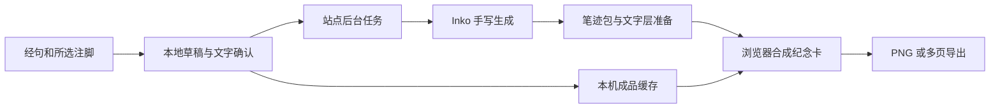

# InfiDao 手写阅读纪念卡接入方案

将用户选中的经句与注脚制成手写纪念卡，入口放在温故与停驻阅读之后。经文阅读、释义和水膜交互即时可用；手写生成作为用户主动选择的异步导出任务。一次阅读的结语可以承接纪念卡，但连续经文流无需增加强制结束步骤。

本方案定义接入模块、接口和验收标准。手写纪念卡、持久生成任务、透明墨迹准备及浏览器合成已在本地接通；公网发布与真实前台 60 FPS 验收仍单独记录。

## 现有能力与接入位置

| 现有位置 | 可复用能力 | 接入方式 |
| --- | --- | --- |
| [LibrarySheet.tsx](../../src/components/flow/LibrarySheet.tsx) | 最近阅读、收藏、注脚、返回阅读、导出全部注脚 | 在选定经句或注脚后提供制作纪念卡的操作；批量文字导出继续保持原语义 |
| [FlowMenu.tsx](../../src/components/flow/FlowMenu.tsx) | 停驻阅读时的收藏、注脚、温故入口 | 可进入当前经句的纪念卡草稿，不在滚动途中自动弹出 |
| [NotesPanel.tsx](../../src/components/flow/NotesPanel.tsx) | 注脚编辑与上下文 | 为用户选择的那条注脚建立草稿快照 |
| [storage.ts](../../src/lib/flow-browser/storage.ts) | 路径、注脚、阅读快照和本地持久化 | 通过独立导出缓存关联来源，不把大图片写入阅读路径记录 |
| [FlowExperience.tsx](../../src/components/flow/FlowExperience.tsx) | 阅读状态、当前经句、面板与返回位置 | 挂接导出面板，保存打开前的阅读位置和停驻状态 |
| [session route](../../src/app/api/flow/session/route.ts) | 站点服务端会话入口 | 手写服务沿用站点服务端边界，新增独立任务路由 |

经文字体、字号与字重继续遵循阅读界面的既有规范。手写字迹是纪念卡的内容样式，不能成为浏览器显示新经句的前置条件。

## 产品流程与卡面内容

1. 用户在温故中选中经句或注脚，点击“留成手写纪念卡”。停驻阅读入口可直接带入当前经句。
2. 本地先显示草稿：经句、来源、章节、选择的注脚、日期、可选落款。用户可以取消某个内容区块。
3. 经句作为引用保留原字、原标点与原章节；注脚的修改先作为导出草稿处理，保存回原注脚另走现有编辑操作。
4. 用户选择字迹和版式，预览本次将发送给 Inko 的准确文字，再主动开始制作。
5. 显示排队、书写、整理卡面与可保存状态。制作期间可以返回阅读，稍后从同一草稿查看结果。
6. 完成后预览并下载 PNG；长注脚超出单页时分页，不截断或自动摘要。多页可以逐页保存，PDF 作为相同内容的附加导出格式。

如果增加阅读结语页，正文先显示普通可读文字，再提供“制作手写版”。结语内容确定且用户已启用手写制作后，才允许提前准备相应素材；未完成的任务不占住结语页面。

卡面以经句和个人理解为主，来源、章节和日期应清楚可读。未经用户填写的落款保持空白，不代签真实姓名。

## 生成与合成架构



新笔迹由 Inko 云端生成。后台下载结果并准备适合卡面的文字层；浏览器完成卡纸、来源与个人选项的合成。首次接入可在后台使用 Python、Pillow 和 numpy 复用上游高质量渲染，再评估是否需要把该渲染器移植到浏览器。

Inko 默认输出整页图片；透明文字层不是现成的 API 参数。新增文字层准备器应复用 `scene.zip` 的逐字位置、墨迹与笔触处理，保留灰度和抗锯齿，避免用硬阈值抠白损坏细笔画。可编辑包只包含已经生成的字形，不能作为完整字体生成任意新经句。

最终合成须按上游输出规则保留 AI 标识和 AIGC 元数据。Canvas 的 `toBlob` 或 `toDataURL` 不会自动继承输入图片的元数据，应由成品封装器补齐。账号具备免显式标识能力时，再按其实际授权处理。

## 模块与职责

下列模块已接入，后台运行方式见 [运行说明](../../scripts/handwriting/README.md)。

| 模块 | 职责 |
| --- | --- |
| `src/components/flow/ReadingKeepsakeSheet.tsx` | 内容选择、准确文字预览、字迹与版式选择、制作状态、保存 |
| `src/lib/handwriting/contracts.ts` | 草稿、来源摘要、任务状态、素材与错误合同 |
| `src/lib/handwriting/reading-draft.ts` | 从经句和所选注脚建立不可变草稿，计算内容摘要 |
| `src/lib/handwriting/client.ts` | 同源请求、任务恢复、有限频率轮询与取消 |
| `src/lib/handwriting/cache.ts` | 独立 IndexedDB 导出缓存、来源修订失效与清理 |
| `src/lib/handwriting/compose-reading-card.ts`、`compose.worker.ts` | 卡面排版、图片合成、分页与最终元数据封装 |
| `src/lib/server/handwriting/`、`scripts/handwriting/` | Inko 适配、SQLite 持久任务、独立 Worker、素材准备及访问控制 |
| `src/app/api/handwriting/` | 能力查询、创建、查询、取消、恢复与取回素材的 HTTP 边界 |

导出缓存使用独立数据库或独立存储层，避免为图片缓存破坏现有阅读数据库迁移与失败覆盖机制。面板和合成依赖按需加载；图片解码、大尺寸合成与压缩放在异步任务或 Worker 中，不进入经文流逐帧绘制函数。

## 草稿和站点接口

本地草稿至少包含以下数据：

```ts
type ReadingKeepsakeDraft = {
  draftId: string;
  sourceRef: { pathId?: string; frameId?: string; noteId?: string; noteRevision?: string };
  createdAt: number;
  quote: string;
  sourceLabel: string;
  chapterLabel: string;
  noteText?: string;
  dateLabel: string;
  signature?: string;
  styleCode: string;
  layoutVersion: string;
  contentDigest: string;
};
```

这些来源标识用于本地追溯，不发送给 Inko。阅读数据主要在设备上，因此服务端不能仅凭 `noteId` 获取正文；创建任务时必须提交用户确认过的文字快照。

| 已接入接口 | 约定 |
| --- | --- |
| `GET /api/handwriting/capabilities` | 返回会话缓存范围、实际可用字迹和后台配置状态 |
| `POST /api/handwriting/jobs` | 提交 `requestId`、准确正文、`contentDigest`、字迹、版式及本次发送确认；返回 `202` 和项目任务 ID |
| `GET /api/handwriting/jobs?requestId=...` | 网络不确定时按原请求恢复；未知请求返回 `404` |
| `DELETE /api/handwriting/jobs?requestId=...` | 先记录撤销，再清理对应任务；晚到的创建请求被拒绝 |
| `GET /api/handwriting/jobs/{id}` | 返回任务状态、原草稿摘要、已完成页数和受控素材地址 |
| `POST /api/handwriting/jobs/{id}/cancel` | 幂等取消任务；取消后即使上游完成，也不自动展示旧结果 |
| `POST /api/handwriting/jobs/{id}/retry` | 整理失败时复用原上游任务继续准备，不重新生成笔迹 |
| `DELETE /api/handwriting/jobs/{id}` | 清理本站文字与素材，并尽力同步上游取消 |
| `GET /api/handwriting/jobs/{id}/assets/{asset}` | 校验任务归属后返回素材；不向浏览器暴露 API 密钥 |

项目任务状态为 `queued → running → preparing → ready`，另有 `failed`、`cancelled` 和 `expired`。上游的 `succeeded` 只说明生成完成，素材尚未下载或处理时仍显示 `preparing`。

创建请求使用稳定的幂等标识。提交超时先查原任务，不能用新标识直接重复生成。草稿改变后生成新的内容摘要；旧结果只可作为旧草稿的成品查看，不能覆盖新文字。

## Inko 接入顺序

1. 服务端从部署环境读取 `INKO_API_KEY`。普通中文经句使用 `lyric-1`，字迹通过账号可用列表选择并固定实际编号。
2. 调用 `/quote` 校验文字和实际报价；定制文本框时同时调用 `/layout`，确认没有未排入的文字。缺字要定位到原文，不自动改成同音字、简体字或空白。
3. 实施时保持零生成费用上限；只有明确有效且为零的报价才提交。上游价格或字段变化应返回配置错误，不能把字段缺失当作免费。
4. 向 `/generations` 提交正文或正式布局，显式要求 `scene: true`，并带稳定的 `Idempotency-Key`。
5. 后台按上游建议间隔查询状态，处理排队、频率限制与失败；浏览器只查询本站任务，不重复承担上游轮询。
6. 取回 PNG、所需 PDF、`scene.zip` 与生成元数据，持久化后再准备文字层和成品。
7. 上游签名链接有效期有限，成品缓存使用本站或本机地址。API 任务所需文件全部保存后，可以调用 `/delivery-complete` 请求提前清理上游副本，并记录其返回状态。

长任务使用可恢复的后台处理器。部署在无服务器环境时，应配置持久任务与独立 Worker，不能依赖 HTTP 路由返回后仍继续执行的临时回调。

## 缓存和个人内容

缓存身份至少包含项目、当前用户或会话、准确正文、字迹编号、模型、笔型、布局与渲染器版本、落款及标识模式。同文不同落款或不同版式不能误命中同一成品。

经文和注脚保留原文语义，仅统一传输换行等必要编码，不做繁简转换或自动润色。相同快照命中本机成品时，直接预览；新文字仍需一次新生成。

默认只发送用户在预览中选中的文字。整本阅读历史、其他注脚、知识图谱和设备标识不进入生成请求。私人注脚的缓存按用户隔离，不能进入公开的跨用户素材缓存。

注脚修订、来源移除或用户清理导出记录时，使关联缓存失效并取消未完成任务。下载到用户自行管理目录的文件应明确交由用户保管，不能宣称应用能够远程撤回这些副本。

当前注脚保存与删除已接入失效操作；当前阅读存储没有删除整条路径的公开操作，缓存保留路径失效接口供后续接入。来源修订使用时间与文字 SHA-256 摘要，清理标记不保存注脚明文。原注脚编辑仅等待本机失效标记，后台撤销异步重试；导出服务不可用时不会阻塞原注脚操作。

## 等待和失败处理

| 情况 | 用户反馈和处理 |
| --- | --- |
| 排队或较长时间生成 | 显示真实阶段，可返回阅读并稍后查看，不显示虚构完成百分比 |
| 文字无法生成 | 标出具体字符与位置，保留草稿，等待用户选择如何修改 |
| 长注脚排版溢出 | 增加页数或让用户调整版式，不静默删句 |
| 网络或服务错误 | 显示可重试状态，沿用原任务和幂等标识核对是否已提交 |
| 用户取消或修改原文 | 结果与原摘要绑定，禁止把晚到结果放进新草稿 |
| 上游链接过期 | 通过任务重新获取链接；文件已被清理时说明需要重新制作 |
| 手写功能未配置 | 原有经文、注脚编辑和文字导出照常可用，手写入口明确显示配置状态 |

## 实测依据与性能目标

2026-10-24 在 Ego Lite 和本机完成过一份 63 字经文样本：首次云端生成从确认到原图加载约 15.1 秒；同一笔迹包在本机 Python 中三次重建 PNG 和 PDF，中位约 0.69 秒，未修改的高清 PNG 与云端原图逐像素一致。

63 字位图预览的六秒平移采样约为 29.6 FPS，且一次撤销出现约 0.62 秒延迟。该结果不包含 InfiDao 水膜，也不是浏览器完整笔触渲染的验收；不能据此宣布本项目已达到 60 FPS。短文首次生成、缓存后的显示、本地合成和主阅读帧率必须分别计时。

## 实施顺序

### 本次接入的模块决定

- 沿用深色阅读面板和 20 / 16 / 12 字号、400 / 500 字重。面板顺序为内容选择、准确发送预览、字迹与纸面、生成阶段与下载；纸面提供素笺和白笺，经文字体不变。操作沿用现有面板进出与焦点恢复，不增加阅读动画。
- Next.js 负责现有会话认证、输入校验和受控素材路由；独立 Python Worker 负责 Inko 适配、原图归档和透明墨迹。任务保存在专用目录的 SQLite WAL 数据库，事务领取与租约使进程重启后可恢复。HTTP 请求不启动后台循环。
- 服务端以 `HANDWRITING_DATA_DIR` 指定私有持久目录，单 Worker 串行处理，默认仅接受每会话一个未完成任务；任务及素材七天后清理。沿用现有 Flow Cookie，新增只读会话校验以兼容浏览器同源 GET。
- 浏览器仅发送已选择的准确文字、区块范围和固定生成配置；路径、注脚 ID 与修订摘要仅在独立 IndexedDB 中保存。Worker 保留灰度笔触，浏览器独立 Worker 合成纸面并封装带 AIGC / XMP 的 PNG 与同内容 PDF。
- 上游渲染代码固定到 `pretend1111/inko-skill` 的 `a1e2d4929d8e97807961a536d7f1e224f5e42b31`，保留 MIT 许可证。仅复用本地渲染函数，不运行上游登录、密钥发现或浏览器编辑器。
- 报价必须明确为零；任何未知报价、缺字或未排入字符均停止生成。新功能发布仍按本方案验收后另行进入发布流程；已有 60 FPS 目标继续单独记录。

1. 定义草稿快照、独立缓存和状态合同，接通经句与注脚来源。
2. 建立服务端任务适配及所选文字确认，跑通生成、取消、恢复和素材保存。
3. 完成高质量文字层、纪念卡版式、完整文字分页与 PNG 封装。
4. 接入温故和停驻阅读入口，核对返回阅读位置及原功能。
5. 在目标设备上验收阅读性能、成品质量、失败恢复和私人内容清理后，再进入发布流程。

## 验收标准

- [x] 温故和当前经句均能建立准确草稿；来源、章节、日期和注脚归属一致。
- [x] 用户确认前不发送个人注脚；请求体只包含预览中选中的内容。
- [x] 首次生成在后台进行，阅读、释义、收藏与原文字导出不等待该任务。
- [x] 缓存命中不重复调用上游；同字迹、同正文、同版式可稳定复用同一成品。
- [x] 缺字、长文、超页、失败、取消和晚到结果均有明确处理，原文没有漏字或自动改写。
- [x] 文字层保留细笔画、抗锯齿与所选笔触；最终卡面的来源、落款和标识没有遮挡。
- [x] PNG 和多页导出保留应有标识与元数据，不把无标识字形图集当成最终成品。
- [x] 清理或修订注脚会使任务与关联缓存正确失效，不同会话不能读取对方后台素材。
- [x] 返回阅读后恢复原位置。
- [ ] 按相同设备、分辨率、画质和操作路径对照测量水膜性能。60 FPS 目标以真实前台实测为准；用户已同意继续单独迭代。
- [x] 生成、合成与阅读帧率分开记录，Python 导出速度不作为浏览器渲染通过的证据。

## 本地验证记录（2026-10-24）

- 通过已登录的 Ego Lite 取得现有 Inko 密钥，仅写入项目忽略的 `.env.local`；没有创建新密钥或调整账号设置。本地配置固定 `FLOW_SESSION_SECRET`，支持 Web 进程重启后恢复原会话任务。
- 本地阅读入口为 `http://127.0.0.1:3244/infidao`，独立制作后台已启动；连接确认返回 3000 份实际可用字迹，阅读页与能力接口均为 `200`。启动时已指定匹配的本地来源地址。
- 真实样本使用公开经句和合成测试注脚，共 232 个 UTF-16 单位、196 个计费字符，生成两页，实际费用为零；云端创建至完成为 11.556 秒，包含排队。
- 浏览器首次取回素材并合成两页约 4.927 秒，包含首次模块加载和网络时间；缓存恢复不新增生成请求。该数值不能作为纯合成 CPU 时间或阅读帧率。
- PNG 均为 2480 × 3508，约 300 DPI；多页 PDF 的内嵌图像与对应 PNG 像素一致。AIGC 与原 XMP 保留，新增编辑标记；可见原标识、来源与落款没有遮挡。
- 两页墨迹分别保留约 58 万、51 万个半透明抗锯齿像素；在白底上重建与上游原图的最大灰度差为 1。场景正文与提交正文完全相同，没有缺失字形位置。
- 后台浏览器实测通过准确发送、草稿不覆盖原注脚、返回位置恢复、刷新恢复、移动布局、拒绝晚到缓存、清理后后台 `404` 及另一会话访问 `404`。功能验证使用减少动态效果设置，不作为正常水膜画质或前台 60 FPS 的验收。
- 相关 Jest 八组共 81 项、Python 17 项通过；应用类型检查和本次修改文件的 ESLint 均通过。未执行新增功能的生产构建与公网部署。
- 当前 `lyric-1` 对“萬、爭、處、眾、惡、幾、經”等样本文字返回缺字。界面显示位置并保留草稿，不自动繁简转换、删字或换字。
- 真实测试任务已执行清理，本站原始素材已删除；仅保留外部验证目录中的测试成品和必要核对记录。测试均使用公开或合成内容，未发送现有私人注脚。

上述为 2026-10-24 本地验收时的状态。2026-10-25 已提交、推送并完成公网部署，Python 环境、私有持久目录、独立 Worker 及同源 API 代理均已配置，详见[公网发布验证记录](../qa/web-flow-migration/2026-10-25-inko-public-and-tongye-entry.md)。60 FPS 仍按已确认决定单独迭代。

## 参考资料

- [Inko 项目及许可证](https://github.com/pretend1111/inko-skill)
- [Inko API 与任务生命周期](https://github.com/pretend1111/inko-skill/blob/main/inko-handwriting/references/api.md)
- [Inko 自定义排版](https://github.com/pretend1111/inko-skill/blob/main/inko-handwriting/references/layout.md)
- [可编辑笔迹包与本地渲染](https://github.com/pretend1111/inko-skill/blob/main/inko-handwriting/references/scene.md)
