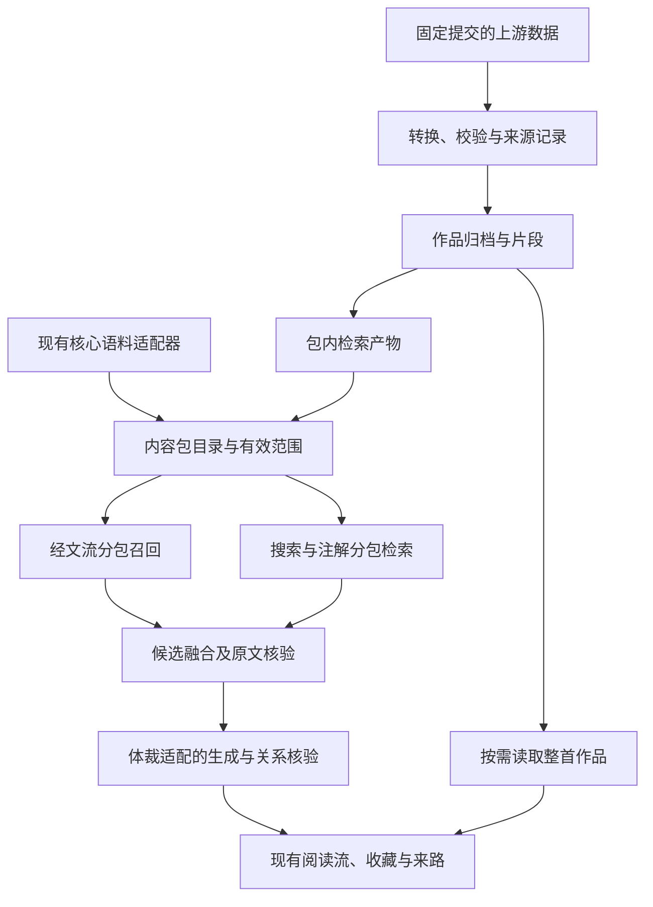
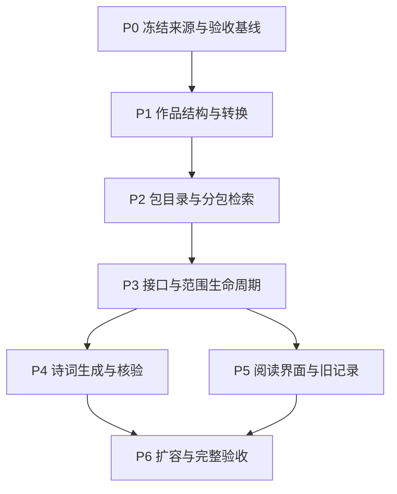

# 诗词内容包与统一阅读流实施计划

## 1. 目标与确认状态

在现有“六经注我”中加入可选的“诗词篇”，复用一念、连续阅读、点词探索、温故、收藏与注脚，使经典阅读同时容纳义理思考、情感表达和审美体会。

依据为本次对话中的内容扩展建议、2026-10-29 的只读核查，以及下文列出的项目代码和上游资料。用户于 2026-10-29 明确要求开始执行，并授权 commit、push 和同步腾讯云服务器；本计划中的架构、接口和默认行为在本次实施范围内获得确认。其后单独批准 1 个只读评审 agent；没有创建新分支或 worktree，复用现有工作空间。

推荐采用“核心典籍＋可选内容包”，使用底层数据并自建转换与索引流程。诗词篇完成后，史传篇、诸子扩充和古文篇可沿同一机制规划，具体优先级另定。

本计划采用分阶段交付，但最终目标包含内容管理、完整作品、两条检索路径、解读适配、旧记录兼容和规模验证。完成样本导入不等于完成诗词篇。

**2026-10-29 范围调整（用户已确认）：** 首批由全目录扩容改为精选 **1,000 首**。作品展开、点词、跨典籍阅读、版本与历史记录、质量与性能要求保持；未收录的大库不随本轮提交或部署。以唐诗三百首标签和宋词三百首为骨架，再按作者、体裁和情境补足；逐条清单保存于 `data/poetry/selection.json`。后续扩容另行决定。用户同时批准 1 个只读评审 agent，用于本轮通用代码审查与冻结后的独立检索样本验收。

## 2. 当前基线与依据

| 已核查事实 | 对计划的影响 | 依据 |
| --- | --- | --- |
| 当前清单有 14 部典籍；两个文件分别为 20、11,809 条，共 11,829 条加载记录 | 这是加载口径，不能直接称作经文流可用数量 | `data/corpus-manifest.json`、`data/rysxguji/README.md` |
| 按经文流现有规则去重及过滤后为 11,722 条：跳过 1 条重复记录、106 条含私用区字符的记录 | 数据报告要分别列原始、去重、过滤和实际可召回数量 | `src/lib/flow/candidates.ts` 的 `flowCorpus` |
| `loadCorpus` 并行读取全部文件，再合并为数组；当前候选库与词法索引长期驻留内存 | 不能把近 40 万条直接追加到现有全量路径 | `src/lib/data/corpus.ts`、`src/lib/flow/candidates.ts` |
| 现有语料以典籍段落为单位，没有独立的作者、朝代、整首作品与分行结构；未知来源的默认 ID 前缀为 `classic` | 新作品需要独立元数据和稳定标识，不能沿用默认 ID 拼接规则 | `src/types/index.ts`、`src/lib/data/corpus.ts` |
| 经文流引用必须是原文连续子串；当前首次匹配位置由 `indexOf` 得出 | 同首复沓句、简繁变体和全文选词必须明确引用位置 | `src/lib/flow/candidates.ts`、`src/lib/flow/service.ts` |
| 传统搜索要求语料与向量逐条匹配，并校验文本哈希、整体版本和孤儿条目 | 加入语料却没有同步索引会使搜索报错；核心与诗词产物应隔离 | `src/lib/search/index-store.ts`、`src/lib/data/embeddings.ts` |
| 经文流入口强调“可辨认的矛盾”，生成与核验强调区别、条件和认识的推进 | 诗词适配必须同时修改规划、生成和核验，不能只换生成提示 | `src/lib/flow/candidates.ts`、`src/lib/flow/service.ts`、`src/lib/flow/relations.ts` |
| 经文流语义索引最多保留 256 项、有效期 6 小时，来自已核验解释 | 它是短期辅助缓存，不能替代诗库的离线意象索引 | `src/lib/flow/semantic-index.ts` |
| 收藏、图谱与重新接续依赖来源、版本、哈希及位置；当前 IndexedDB 为版本 4 | 新增包不能改写旧标识，也不能照搬旧文档中的数据库版本 2 | `src/lib/flow-browser/library.ts`、`src/lib/flow-browser/graph.ts`、`src/lib/flow-browser/storage.ts` |
| 前端续读预取以链 ID 与游标为键；服务端具有请求指纹、租约及原子完成机制 | 内容范围必须进入请求、缓存和预取身份，防止停用后交付旧候选 | `src/lib/flow-browser/prepared-provider.ts`、`src/lib/flow/session-store.ts` |

上游 README 声称近 40 万首，覆盖唐宋诗词、元曲、楚辞等，也包含与本项目重合的《诗经》《论语》等。此数量不是本项目已导入数量或质量承诺。当前已核对服务仓库许可证为 GPL-3.0，底层 `fix-typo` 分支根许可证为 MIT；尚未逐目录核验全量数据、现代整理内容或作品准确性。

本计划不以“经史子集已经齐备”为前提。当前《左传》提供历史叙事，但不等于史部完整；加入诗词也不等于古文、散文已经覆盖。

## 3. 需求与边界

| 编号 | 必须交付的行为 | 主要实施单元 |
| --- | --- | --- |
| R1 | 核心典籍与诗词共用一念和连续阅读，支持情感、意象与审美输入 | P4、P5 |
| R2 | 内容包有独立版本、来源、许可、能力、启用状态和索引，可验证、更新、停用与回退 | P0、P1、P2、P3 |
| R3 | 选句可回到同版本整首作品，作者、朝代、篇名、分行和引用位置准确 | P1、P3、P5 |
| R4 | 两条检索路径均遵守内容范围，跨包关联自然，原有核心检索不退化 | P2、P3、P4、P6 |
| R5 | 收藏、注脚、来路与阅读图谱兼容旧数据；更新或停用不删除已读内容 | P3、P5、P6 |
| R6 | 去重、异文、简繁、归属争议与缺字有明确处理和可追溯记录 | P0、P1、P5、P6 |
| R7 | 大规模接入经过冷启动、内存、召回、首句、续读和前端阅读验证 | P2、P6 |
| R8 | 沿用已确认的简洁界面、原文真实性、会话隔离与额度规则 | 全部 |

本轮推荐范围：

- 诗词篇本轮固定精选 1,000 首，覆盖唐诗、宋词、宋诗及少量五代词、元曲、楚辞、汉诗与清词；逐条来源及选择依据由 P0 固定，不以全目录覆盖作为本轮目标。
- 同时处理与核心典籍的重收关系；已有《诗经》《论语》等以当前核心来源为主，不通过重新导入制造“新增内容”。
- 面向现有网页阅读系统交付；修改共享协议或控制器时验证小程序共享运行时兼容。小程序独立内容包设置界面和新一轮小程序发布不在本轮范围。
- 内容包部署在项目自有数据路径，阅读时不依赖上游在线 API。首期无需内容商店、付费体系、用户上传、跨设备同步或新数据库服务。
- 不改整体视觉架构，不新增一级导航或独立诗词查询产品；不改变现有模型额度与会话安全要求。

## 4. 推荐设计

以下方案于 2026-10-29 获用户执行授权。接口名称表达职责与边界，不是可直接复制的实现代码。

### 4.1 产品行为与内容包状态

默认保留核心典籍，诗词篇由读者在现有“阅读选项 → 阅读来源”内主动启用。用户于 2026-10-30 再次明确要求有地方控制是否选作来源；本次菜单显示“核心典籍 · 始终选用”和独立诗词开关。设置沿用当前浏览器、当前域名的本机存储；不增加账号要求或把两域名偏好同步作为隐含需求。

| 状态或操作 | 新内容召回 | 已有内容与界面行为 |
| --- | --- | --- |
| 未启用诗词篇 | 仅核心典籍；不初始化诗词正文和重型索引 | 原有阅读行为保持一致 |
| 主动启用且包可用 | 从核心与诗词分别召回，再按相关性融合 | 不强制每段出现诗词，也不切换阅读页面 |
| 主动停用 | 后续新召回排除诗词；取消旧范围的预取和未交付请求 | 已读诗句、收藏、注脚与来路保留；已有内容可回看 |
| 当前链的内容范围发生改变 | 下一次主动接续建立使用新范围的子链，旧链保留为来路 | 不在同一游标下偷偷替换候选范围，不因开关立即消耗模型额度 |
| 打开已停用包的旧记录 | 可用旧原句作为经过核验的阅读上下文，新目标仅来自当前启用范围 | 不自动重新启用内容包；打开记录本身不生成新内容 |
| 可选包缺失、损坏或不兼容 | 隔离该包，核心仍可用；准确告知本次实际范围 | 不展示未经校验的原文，不把失败当成启用成功 |
| 核心包损坏 | 保留明确的现有错误处理 | 不以诗词结果掩盖核心故障 |

内容包仅处于“已校验可用”状态时才允许启用。读者设置开关与服务器撤下某版本是两件事：前者影响自己的新召回，后者影响该版本可用性；两者都不能清空用户记录。

### 4.2 内容包、作品与片段

| 层次 | 必要信息 | 标识和版本规则 |
| --- | --- | --- |
| 内容包 | `packId`、展示名、包版本、格式版本、来源仓库与提交、目录清单、许可声明、校验和、统计、索引能力 | 包版本描述一次不可变构建；目录版本描述本次可用包组合 |
| 作品 | `workId`、作品修订、篇名、作者及归属状态、朝代及依据、体裁、词牌或曲牌、原文、分行与分节、来源定位 | 作品标识不因排序或增补其他作品改变；作者不详与归属争议可明确表示，不强填 |
| 阅读片段 | `passageId`、作品引用、原文连续范围、文本哈希、检索派生字段 | 短诗可整体成为片段；长诗按完整诗节或语意单元划分，保存整首坐标 |
| 引用 | 片段引用、原文哈希、起止位置，以及可推导的整首位置 | 保留现有片段坐标含义；重复句必须有明确位置，不能默认第一次出现 |

- 保留当前核心语料和 ID，使用适配器把现有两份文件作为一个逻辑核心包接入。`data/corpus-manifest.json` 继续描述核心数据；诗词不直接混入其文件列表。
- 建议新增 `data/content-packs/manifest.json` 管理可用包；诗词的正文、元数据、来源记录、索引与质量报告独立存放于 `data/poetry/`。
- 新作品标识使用持久映射表和明确命名空间，不使用数组下标、可变篇名或默认 `classic` 前缀作为唯一依据。无上游稳定 ID 的记录首次分配标识并保存映射，后续歧义进入核查队列。
- 区分目录版本、包版本、作品修订与检索索引版本。新增诗词包不改变 `guji-core-v1`；包内新增其他作品，也不应改变未修改作品的引用身份。
- 新增来源引用字段承载包、作品修订和片段身份；旧字段继续兼容。旧记录按原身份验证，新记录按不可变作品修订验证，不能取消哈希检查来“兼容”更新。
- 统一原文换行约定后固定规范文本。坐标沿用 JavaScript 字符串的 UTF-16 偏移，并校验代理对边界；字符分词、展示分行和原文坐标分别管理。
- 简繁转换与检索归一化生成派生字段，不覆盖规范原文。本轮默认引用保持原字；若显示派生字形，必须能还原到准确的原文范围。
- 完全重复作品合并召回并保留全部来源；异文保留独立修订或版本关系。不能因归一化后相同就删除不同版本，不能把重收或异写作为新的跨典籍见解。

### 4.3 数据与检索路径

此图用于说明模块关系，具体实现以确认后的职责和契约为准。

1. **离线构建，运行时本地读取。** 固定上游提交，生成确定性的作品、片段、来源、去重映射、索引和校验报告；正式阅读不请求上游服务。
2. **正文与索引分开。** 作品正文按分片存储，建立可直接定位的作品目录；按需读取并使用有容量上限的缓存。核心请求不触发诗词索引初始化，未启用诗词不增加核心冷启动的重型工作。进程中已被其他读者使用的公共索引可以留在有界缓存中，但每个请求都必须按自己的有效范围筛选，不能因缓存存在而扩大召回范围。
3. **先分包召回，再融合。** 每包提供有限候选；包内结合原文字词、篇名作者、意象和情境字段，跨包按名次融合并做重复作品与来源多样性控制。不直接比较不同模型的原始向量分数，不以固定诗词比例强行填满结果。
4. **具体查询保留优先权。** 用户明确查篇名、作者或原句时，不为平衡内容来源而稀释准确命中；一般处境查询才采用跨包多样性约束。
5. **意象索引可追溯。** 如“月”“归舟”“暮春”等关联保存对应原文、编辑依据和索引版本；模型辅助标签仅作为可审核的派生检索信息，不写成作者本意或历史事实。离线标签只依据作品资料，不把用户一念、注脚或个人联系写入公共内容索引。首期不新增运行时标签生成调用。
6. **传统搜索同步适配。** 每包独立验证向量模型、维度、片段覆盖、哈希与版本；可选图谱也按包校验并保持现有非阻断行为。搜索返回的诗词必须能继续注解、点链接和打开来源。
7. **保持有界计算。** 检索候选数与模型输入长度继续有上限，扩大语料不扩大模型上下文。把向量孤儿检查中逐条扫描语料的逻辑改为集合查验，避免在扩容后出现平方级检查。
8. **存储选型以规模证据收口。** 首选预构建的本地索引与分片正文，不引入外部服务。若完整目标规模无法满足 P0 冻结的预算，必须调整并确认受影响的存储设计，不能悄悄删减最终覆盖或直接把全库常驻内存。

### 4.4 接口、范围与缓存契约

现有端点保持可用。下表的新增可选字段和只读端点已获本轮执行授权；实现时需同步类型、严格请求校验、客户端和测试。

| 边界 | 拟定契约 | 兼容与失败行为 |
| --- | --- | --- |
| 内容包目录 | 新增只读目录接口，返回可展示的包信息、状态、版本和来源声明 | 不暴露内部文件路径；不接受客户端传入任意数据位置 |
| 作品详情 | 新增按包、作品及修订读取的只读接口，返回整首、元数据、分行和片段位置映射 | 仅解析目录中已登记的不可变作品；找不到指定修订时不换成最新版冒充 |
| `POST /api/flow` | 新增可选内容范围；新链记录服务端解析后的包版本组合与范围指纹 | 老客户端创建新链时默认核心；老续读请求继承其链的范围 |
| 阅读范围切换 | 新增显式“从当前已读节点按新范围继续”的开放入口，创建子链并保留来路 | 原链游标不能用于新范围；使用同一会话中已核验节点，或重新验证本机记录的原文引用 |
| `POST /api/search` | 新增可选内容范围；结果可附作品和来源元数据、实际可用范围 | 缺省保持核心及原响应字段；可选包失败时说明降级，不破坏核心结果 |
| `POST /api/annotate` | 同步来源解析与内容范围，候选链接受当前范围约束 | 旧请求与确定性回退保持可用；新诗词不能查得到却注解失败 |
| `FlowFrame` | 添加可选的作品引用、作者/朝代展示信息、体裁、分行及整首位置 | 保留 `fullText` 的现有片段语义；完整作品按需展开，不把长诗塞进每个流事件 |
| 本机收藏与图谱 | 新引用采用作品修订与片段范围；旧引用仍按原规则读取 | 兼容性映射只在内容确实一致时使用，禁止改写已有注脚或把不同异文合成同一节点 |

整首点词由作品详情提供的片段映射定位，再由服务端核验到具体片段和原文坐标。跨片段的大范围选择提示缩小范围，不拼接不连续原文；定位不到时保留当前阅读并解释原因。

内容范围至少进入：服务端请求指纹、操作去重键、分支复用键、预取键、候选索引缓存、语义缓存与注解缓存。检索配置和提示版本也参与相应缓存身份，避免改规则后复用旧结果。

每条链固定其范围及可用版本组合。切换设置时取消前端在途消费、丢弃旧预取，并使用新的请求身份；已经开始的旧请求即使在服务端完成，也不能进入新范围的阅读。服务端撤下包版本时，旧链不能继续从该包召回，应提供保留旧阅读、按当前可用范围接续的明确路径。

恢复过期会话的本机记录时，只能依据服务器可核验的来源重建上下文；不能把客户端上传的解释或未核验历史当成可信古文。无法恢复服务器历史时如实重启阅读，保留本机来路。

### 4.5 诗词解读与关联

- 入口理解允许义理问题、情感表达、审美观看和纯粹好奇，不要求读者在界面选择模式，也不把每个输入都解释为矛盾或困境。
- 诗词元数据与必要上下文进入规划、生成和核验。短诗可提供整首；长篇提供当前完整诗节、相邻语境与作品定位，不能只凭截取的一句编造全篇意义。
- 释义说明必要词义、典故及语境；当前联系承认多义和不确定性。未经核查的生平、创作年份、作者心理及典故不写成事实。
- “新增理解”可体现为情绪层次、意象变化、视角或节奏上的区别，不要求每句提供行为建议。赏景和闲适输入不得强行导向焦虑、规训或自我反省。
- 同字不构成关联证据。跨典籍联系可以是相近、对照或展开，应说明语义连接；没有依据时不声称因果、影响或思想传承。
- 规划、点词解释、重启入口、生成与关系核验同步适配；保留原文逐字核验、专业问题边界、真实流式交付和现有修复次数及额度限制。

### 4.6 更新、旧记录与回退

- 已发布作品修订保存为不可变、可按内容定位的归档；更新生成新产物并完整校验后再切换目录。复用未变化作品，不重复拷贝整包正文。
- 只更新诗词包时不重建或改写核心语料身份；不改已保存帧的原文、释义、注脚及收藏键。
- 同一内容的新包版本通过作品修订识别；正文校勘产生新修订，旧引用仍定位旧原文。别名迁移必须有一致性证据，不能仅靠标题相同。
- 停用只是退出新召回，不删除原文归档或个人记录。存储清理策略不在本次擅自加入；归档空间需求纳入 P6 的规模报告。
- 回退切换到上一份完整目录和索引组合，同时隔离失效缓存。支持旧客户端读取新增可选字段；更早的应用版本至少能展示保留下来的已读片段快照。
- 不主动升级 IndexedDB 主版本；优先用现有存储区增加可选字段和独立偏好键。若完整作品缓存确需结构升级，先补充迁移设计与拒绝写入、空间不足场景。

## 5. 实施单元与依赖

下列单元在整体方案确认后实施；路径标为“拟新增”的文件当前不应被理解为已经存在。依赖图表示工作先后，不代表已授权启动并行 agent 或创建工作空间。

### P0：固定来源、覆盖清单与验收基线

- [x] 固定上游提交和数据目录，形成逐目录来源、许可、预期体裁及覆盖清单。
- [x] 记录当前核心语料、索引和原有质量门槛；建立后续比较所需的基线和明确数值预算。

**需求与依赖：** R2、R6、R7、R8；无前置实现。

**文件：** 拟新增 `data/poetry/sources.json`、`data/poetry/README.md`、`docs/qa/poetry-content-pack-baseline.md`；参考 `data/rysxguji/sources.json`、`docs/qa/search-quality-methodology.md`。

**工作与验证：** 对短诗、律诗、词、曲、长篇、复沓句、无明确作者、繁简混合、异文和已有典籍重收建立代表性清单；所有拟收录目录都有具体来源和许可说明。基线区分加载数、作品数、片段数、去重数、排除数及缺字数。

**测试预期：** 本单元是资料与基线工作，不为文档新增实现镜像测试；使用已有质量工具和可复现测量。尚未核清的权利或来源阻止对应目录进入可发布包，不阻断独立目录核查。

### P1：作品模型、引用与确定性转换

- [x] 建立包、作品、片段、引用和来源记录结构，完成核心适配与诗词转换。
- [x] 输出稳定标识、分行坐标、去重及异文关系、排除原因与可重建产物。

**需求与依赖：** R2、R3、R6；依赖 P0。

**文件：** 拟新增 `src/lib/content/contracts.ts`、`src/lib/content/core-adapter.ts`、`src/lib/content/references.ts`、`scripts/poetry/build-corpus.mjs`、`data/poetry/identity-map.json`；按需调整 `src/types/index.ts`。测试拟新增 `tests/unit/content/references.test.ts`、`tests/unit/tooling/poetry-corpus.test.ts`、`tests/fixtures/poetry-corpus-cases.json`，复用 `tests/unit/data/corpus.test.ts`。

**主要场景：**

1. 同一来源快照重复构建，内容、ID 与哈希一致；上游记录重排后既有作品 ID 不变。
2. 短诗、长篇和复沓句均能从引用准确定位整首，包含换行和扩展汉字；同文不同位置不串位。
3. 简繁派生文本不覆盖原文；异文保留差异；核心重收只合并召回，出处可追溯。
4. 缺元数据、空作品、损坏记录与私用区字符进入有原因的质量清单，不能静默漏收或臆造作者。

**完成标准：** 样本的所有引用均可机械核验，来源记录覆盖率为 100%；核心记录的 ID、正文及哈希不变。

### P2：内容目录、独立索引与分包召回

- [x] 实现包注册、产物校验、核心适配、按需正文读取和有界缓存。
- [x] 接入经文流与传统搜索的分包召回、意象索引、融合及故障隔离。

**需求与依赖：** R2、R4、R7；依赖 P1。

**文件：** 拟新增 `src/lib/content/registry.ts`、`src/lib/content/store.ts`、`src/lib/content/retrieval.ts`、`data/content-packs/manifest.json`、`scripts/poetry/build-index.mjs`；调整 `src/lib/flow/candidates.ts`、`src/lib/search/index-store.ts`、`src/lib/search/service.ts`、`src/lib/data/embeddings.ts` 及相关图谱产物解析。测试拟新增 `tests/unit/content/registry.test.ts`、`tests/unit/content/retrieval.test.ts`，扩展 `tests/unit/flow-candidates.test.ts`、`tests/unit/search/index-store.test.ts`、`tests/unit/data/embeddings.test.ts`。

**主要场景：**

1. 未启用诗词时不加载其正文和重型索引，核心固定查询结果与基线一致。
2. 诗词大量增多后，核心处境查询仍保留原有相关来源；明确篇名与原句查询准确命中。
3. 模型或维度不匹配、缺向量、陈旧哈希、损坏分片只隔离可选包；不得用部分不一致索引继续返回该包。
4. 候选、内存缓存和正文读取受预算约束，索引验证不做逐条全库扫描；重复作品不挤占结果。

**完成标准：** 两条检索路径都能返回可核验片段；可选包故障不破坏核心；索引和正文可独立重建并核对哈希。

### P3：接口、作用范围与缓存生命周期

- [x] 增加内容包目录和指定修订作品详情接口。
- [x] 接入请求范围、有效版本组合、切换后的新子链、来源重建与缓存隔离。

**需求与依赖：** R2、R3、R4、R5、R8；依赖 P2。

**文件：** 拟新增 `src/app/api/content-packs/route.ts`、`src/app/api/works/[workId]/route.ts`、`src/lib/content/scope.ts`；调整 `src/lib/flow/contracts.ts`、`src/lib/flow/service.ts`、`src/lib/flow/session-store.ts`、`src/lib/flow/semantic-index.ts`、`src/lib/flow-browser/provider.ts`、`src/lib/flow-browser/prepared-provider.ts`、`src/app/api/search/route.ts`、`src/app/api/annotate/route.ts`、`src/lib/annotation/service.ts`、`src/lib/annotation/cache.ts` 及现有调用方。测试拟新增 `tests/integration/api/content-packs.route.test.ts`、`tests/integration/api/works.route.test.ts`，扩展 `tests/unit/flow-route.test.ts`、`tests/unit/flow-session-store.test.ts`、`tests/unit/flow-browser-provider.test.ts`、`tests/unit/flow-prepared-provider.test.ts`、`tests/integration/api/search.route.test.ts`、`tests/integration/api/annotate.route.test.ts`。

**主要场景：**

1. 无新增字段的旧请求继续使用核心；新请求的包清单、作品修订与实际可用范围由服务端核验。
2. 相同文字、不同范围不会共享错误的候选、解释、分支或预取；复用请求 ID 改范围仍被识别为不同请求。
3. 停用期间有在途生成、续读预取或连续切换时，旧结果不能插入新链；当前帧与用户注脚保留。
4. 包更新不影响其他包的旧记录；版本找不到或原文变更时明确失败，不放宽引用校验。
5. 搜索返回诗词后可注解并继续关联；整首点词映射正确；越界、伪造来源和其他会话节点被拒绝。

**完成标准：** 新老请求兼容，切换范围行为与第 4.1 节一致，所有新目标都来自本次有效范围；保持现有额度、租约与所有者隔离。

### P4：诗词规划、生成与关系核验

- [x] 统一适配一念、点词、重启、生成与核验中的体裁规则和上下文。
- [x] 建立情感、审美及跨典籍关联的回归样本，并保留旧处境质量要求。

**需求与依赖：** R1、R4、R8；依赖 P3。

**文件：** 调整 `src/lib/flow/candidates.ts`、`src/lib/flow/service.ts`、`src/lib/flow/context.ts`、`src/lib/flow/relations.ts`、`src/lib/flow/lexemes.ts` 及 `src/lib/annotation/` 中实际使用的提示与回退逻辑；拟新增 `tests/fixtures/poetry-reading-contexts-v1.json`，扩展 `tests/unit/flow-context.test.ts`、`tests/unit/flow-service.test.ts`、`tests/unit/flow-relations.test.ts`、`tests/unit/annotation/service.test.ts`。

**主要场景：**

1. “今晚月色很好”允许赏景，“忽然想家”允许表达思念，不自动补写焦虑、矛盾或处世教训。
2. 同一意象在不同作品中的含义允许不同；易懂原文不强行翻译，不把一种读法说成唯一作者本意。
3. “离别”可沿经过核验的相知、远近等含义进入其他经典；只有同字、重复建议或无证据传承的关联不通过。
4. 作者不详、归属有争议或上下文不足时不补造背景；真实原句和现代联系分开。
5. 既有家庭自主、边界、专业问题和不诊断规则继续成立；修改诗词规则不能削弱原有核验。

**完成标准：** 结构性规则有自动化回归；解释质量经固定样本阅读评估并保留失败例。模拟响应测试不作为真实模型质量通过的证据，真实调用遵守已有上限。

### P5：阅读界面、作品展开与旧记录

- [x] 在现有阅读选项加入轻量内容范围设置，展示作者、朝代与篇名，按需展开整首。
- [ ] 贯通正文点词、收藏、注脚导出、温故、阅读图谱及旧记录恢复，验证新增字形。

**需求与依赖：** R1、R3、R5、R6、R8；依赖 P3，最终语义体验与 P4 联合验收。

**文件：** 调整 `src/components/flow/FlowMenu.tsx`、`src/components/flow/FlowExperience.tsx`、`src/components/flow/ReadingLayer.tsx`、`src/components/flow/LinkedText.tsx`、`src/components/flow/flow.module.css`、`src/lib/flow-browser/storage.ts`、`src/lib/flow-browser/library.ts`、`src/lib/flow-browser/graph.ts`、`src/lib/flow-browser/controller-host.ts`，以及实际需要的 `shared/flow/controller.js`、`shared/flow/classic-text.js` 和字体构建路径。测试扩展 `tests/unit/flow-reading-menu.test.tsx`、`tests/unit/flow-reading-continuity.test.tsx`、`tests/unit/flow-browser-storage.test.ts`、`tests/unit/flow-library.test.ts`、`tests/unit/flow-knowledge-graph.test.ts`、`tests/unit/flow-browser-glyph-parity.test.ts`、`tests/unit/flow-runtime-parity.test.ts`。

**主要场景：**

1. 当前黑底、经轮和连续阅读结构保持；作者信息简洁，分行准确，长篇按需展开且无横向溢出。
2. 从诗句点词进入典籍，再返回原诗，位置、来路和注脚一致；整首点词与片段内点词使用同一原文身份。
3. 收藏后刷新、重开、停用内容包及更新其他作品，仍能看到原句和注脚；导出含准确出处。
4. 使用旧核心快照、版本 4 存储、旧图谱节点验证兼容；存储拒绝、空间不足或详情失败时保留当前内容并明确状态。
5. 未缓存完整作品时离线只显示已有片段，并说明全文不可用；不得把片段标作整首。新增字形在正文与经轮中均可读。

**完成标准：** 网页完整阅读闭环成立；在 320、390、1280 像素和横屏验证换行、触控、键盘焦点与减少动画偏好。共享运行时兼容通过，真实手机未测项单列，不以桌面模拟代替。

### P6：精选 1,000 首的质量与规模验收

- [x] 完成用户确认的精选 1,000 首，生成逐条来源、数量、质量与性能报告；完整大库不纳入本轮发布。
- [ ] 完成核心回归、诗词场景、旧记录兼容、内容范围切换、故障与回退验证。

**需求与依赖：** R1—R8；依赖 P4、P5，复核 P1—P3 的完整规模行为。

**文件：** 拟新增 `docs/qa/poetry-content-pack-acceptance.md`、`scripts/poetry/measure-runtime.ts`、`tests/fixtures/poetry-search-regression-v1.json`、`tests/unit/content/poetry-search-regression.test.ts`；补充 `data/poetry/README.md`、`docs/API_REFERENCE.md` 及实际受影响的来源声明。复用 `tests/unit/search/golden-search.test.ts` 和既有质量评测机制。

**主要场景：**

1. 同一查询集对比核心独立、核心加诗词、停用诗词三种状态；核心独立结果可重现，开启诗词后既有强相关来源不被无关诗词挤掉。
2. 重复作品和繁简异写不制造多个“新发现”；不同作者、体裁和情境均有明确可用范围。
3. 冷启动、首次启用、暖检索、长篇详情、多请求及缓存淘汰均在冻结预算内；同时测量索引校验时间和归档磁盘空间。
4. 更新中断、可选包损坏、旧预取返回和目录回退不会交付版本不一致结果；核心仍可用。

**完成标准：** 全部必需验收项有证据；未解决必需项仍标记未完成。全量目标中每条记录均能追溯至收录、去重归并或有证据的排除结论；待核查记录不得混入“已完成覆盖”。

## 6. 验收门槛与测量方式

| 维度 | 必须达到的结果 | 证据 |
| --- | --- | --- |
| 来源与引用 | 可交付作品来源覆盖率、引用子串及坐标验证通过率均为 100%；无未解释的 ID 冲突 | 构建清单、哈希、异常报告与样本复核 |
| 作品展示 | 选句可返回同修订整首；作者、篇名、分行及全文点词准确 | 类型和集成测试、阅读验收记录 |
| 核心回归 | 未启用诗词的确定性固定查询结果与核心基线一致；保留现有质量门槛 | 原有回归集和冻结基线比较 |
| 跨包召回 | 启用后新增诗词有依据；核心相关来源不被无关结果挤掉；具体篇名、作者和原句查询准确 | 分场景结果及失败例，不以总平均掩盖退化 |
| 解释质量 | 审美输入不被强行问题化；无虚构出处、作者背景和牵强传承 | 真实输出抽查与独立评测，不能仅凭提示文本判定通过 |
| 范围与历史 | 停用后无新的诗词召回；旧记录可查看；范围切换、重试、预取和回退不串数据 | 集成测试、浏览器状态与请求记录 |
| 性能与容量 | 冷启动、启用耗时、RSS 峰值、检索 p50/p95、首个可读帧、续读、全文响应和前端流畅度满足事先冻结的数值预算 | 固定设备、构建、数据规模、查询集、并发、重复次数和冷热状态 |
| 字体与界面 | 新增字覆盖报告完整；正文、经轮与手机视口可读 | 字形对照、必要视觉验证及未测真机清单 |

数值性能预算已在 P0 写入基线文档，精选包按冻结预算测量；具体结果见 `docs/qa/poetry-content-pack-runtime.json`。不把本机索引测量等同于真实模型或生产等待时间，也不承诺“40 万首直接可用”。不能在结果超标后自行放宽门槛。

首句和续读同时记录本地检索耗时与模型耗时，用固定响应或回放隔离本地回归，再单列额度允许的真实模型结果。小样本、多次热缓存或开发服务器结果不得冒充完整规模与生产性能。

保留 `docs/qa/search-quality-methodology.md` 的证据分层。历史 `search-holdout-v1` 已记录失败且不可变，不重跑或改写它作为本次通过证据；新泛化结论需要在实现冻结后建立新版本的独立留出评测。评审人员或 agent 须由用户指定或另行授权，主线程回归不能冒充独立评审。

实施验证覆盖相应单元、集成、类型、Lint、构建和既有必需质量检查；浏览器只用于必要的交互与视觉验收，工具服从项目现有约束。未获发布授权时，在本地候选完成验证和交付记录，不执行公网发布。

## 7. 确认项、风险与交付

本轮已确认的产品和接口选择：

1. 采用本计划的独立内容包架构和 R1—R8 完整范围。
2. 诗词默认关闭，由现有阅读选项主动启用；停用保留旧阅读，范围变更以新子链接续。
3. 同意第 4.4 节对现有请求的可选扩展、只读目录与作品接口；原文默认保留原字，本轮不另建全局简繁切换功能。

以上选择已随执行指令确认；首批 1,000 首另获明确回复。实施范围内的例行转换、排错和验证连续完成，不重复询问同一设计。

执行时需要获得证据的事项：上游固定提交与逐目录许可、最终覆盖清单、异文和归属争议、字体缺口、生产约束下的容量及性能预算。P0 负责固定来源和准入标准；实际存储结构只有在实测证明需要改变架构时才重新确认受影响部分。

| 风险 | 处理 |
| --- | --- |
| 上游规模说明与实际可用作品不一致 | 使用逐目录构建统计，区分作品数与片段数，逐条解释排除与重收 |
| 大量诗词改变排序或拖慢服务 | 独立索引、分包融合、有界缓存、核心回归和完整规模预算共同约束 |
| 诗歌被过度解释成劝诫 | 规划、生成、核验同改，以情感与审美场景验证 |
| 包版本变化使旧收藏失效 | 核心身份不变；作品修订独立；保留旧归档、原快照及可验证映射 |
| 停用与在途预取发生竞争 | 范围入键，旧链保留，新范围另起子链，拒绝消费过期结果 |
| 模型生成标签或背景不可靠 | 与原文分层存放，保存依据并核查，不把派生内容当作史实 |
| 完整作品或字体增加前端负担 | 全文按需读取，字体按现有分片能力补齐，不把整包推入首屏 |
| 缺独立评测或存在必需失败项 | 如实标记验收未完成，不用样本完成或自审替代 |

最终交付应包含：实现与必要测试、版本化数据和索引、来源与许可声明、可重建转换流程、内容数量与质量报告、完整阅读及旧记录验收、规模测量和回退说明。已存在的无关工作区改动不纳入本任务；用户已授权本轮提交、推送与腾讯云同步，仅 1 个只读评审 agent 在已批准范围内工作。

## 8. 资料与引用

- 项目结构导航：`graphify-out/GRAPH_REPORT.md`，用于定位语料、候选、检索、缓存和阅读相关社区；报告日期为 2026-10-20，事实以本次读取的源码为准。
- 核心语料与产物：`data/corpus-manifest.json`、`data/rysxguji/README.md`、`src/lib/data/corpus.ts`、`src/lib/data/embeddings.ts`。
- 连续阅读要求：`docs/plans/2026-10-19-001-feat-connected-reading-plan.md`。
- 温故与个人记录：`docs/plans/2026-10-13-001-feat-reading-library-plan.md`，历史设计中的存储版本以当前 `src/lib/flow-browser/storage.ts` 为准。
- 检索质量与历史证据：`docs/qa/search-quality-methodology.md`。
- [上游 API 仓库说明](https://github.com/palemoky/chinese-poetry-api/blob/main/README.md)：数据范围与 `fix-typo` 来源说明；规模为上游声明。
- [服务许可证](https://github.com/palemoky/chinese-poetry-api/blob/main/LICENSE)：GPL-3.0。
- [底层数据分支许可证](https://github.com/palemoky/chinese-poetry/blob/fix-typo/LICENSE)：MIT；实际选取目录仍需来源及附带说明核查。

以上外部资料于 2026-10-29 在本次对话中通过 GitHub 连接器读取。源数据已固定提交并校验；最终交付证据以本轮精选包验收记录为准。

## 9. 实施记录（持续更新）

已完成精选 1,000 篇、182 位资料署名作者、1,051 个连续片段与 16 个独立分片；72 个正文来源文件逐一对照固定 Git blob。元曲原始合集按 35 个明确源范围收录独立小令；近文记录保留各自原字与归属，机械关系只用于召回多样性，不据此认定学术归属。

引用、向量、SQLite 完整性、作品全文及 5,497 个实际所需字形已逐项验证；同一 Node/SQLite/zlib 环境重建逐分片字节一致。报告见 `poetry-content-pack-integrity.json`、`poetry-content-pack-rebuild.json` 和 `poetry-content-pack-runtime.json`。核心语料与索引产物保持原样。

浏览器已实测阅读来源开关及刷新持久化、停用后旧诗保留、同修订全文、缓存全文离线恢复，覆盖 320、390、1280 像素及横屏；全文页面测试使用 API 核验原文的固定阅读快照，不能作为真实模型质量证据。共享控制器的准备等待和存储等待两类切换竞态已用自动测试及独立复现核对。

独立评审 v1—v3 曾发现元曲边界、精确引用、情境桥接等问题，失败报告原结论保留。公开后的样本仅进入可见回归；新一轮使用另行封存的查询，不以重跑旧样本证明泛化。最终独立检索、真实模型阅读、生产构建、提交推送与腾讯发布尚须在验收记录中补齐证据；这些必需项未通过前，计划继续为 active。
