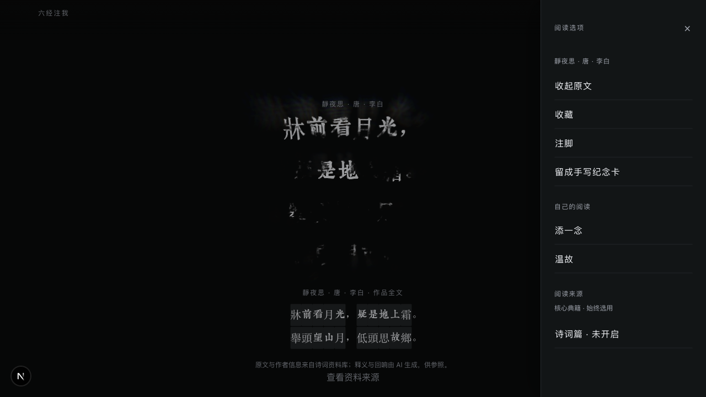

# 诗词篇接入验收

2026-10-29 开始实施，2026-10-30 完成代码交付与腾讯发布。范围以用户确认的精选 **1,000 首**为准。部分人工界面闭环与真实模型续读尚未完成，因此计划 P5/P6 的整体验收仍保持未勾选；不以发布成功替代全部验收。

## 内容与阅读来源

现有核心保持 14 部、11,829 条加载记录（流候选过滤后 11,722 条）。新增唐诗 550、宋词 280、宋诗 60、五代词 25、元曲 35、楚辞 20、汉诗 10、清词 20；共 1,000 作品、182 位资料署名作者、1,051 个片段。内容包版本与校验见 [当前目录](../../data/content-packs/manifest.json)。

阅读页“更多阅读选项 → 阅读来源”可选诗词，核心固定保留。诗词默认关闭，设置保存在当前浏览器及域名；不因开关立刻生成内容或消耗模型调用。停用取消预取及尚未显示的返回，后续主动接续建立新范围子链，已读诗句、来路、收藏与注脚保留。

完整作品按同一修订按需读取，保留分行和源字；重复句必须带正确坐标。全文点词仍沿原作品身份进入同一条阅读流，不另开诗词产品。范围进入候选、请求、生成身份、注解缓存、语义缓存、预取和子链复用身份。损坏或不兼容的可选包隔离后继续核心；旧作品不以最新版冒充指定修订，坏当前包不会挡住有效旧归档。

## 来源、近文与字体

固定 `palemoky/chinese-poetry` 提交 `041b8ab50bdf07bf498bba2d1666b1d1fd707f4e`，72 个实际正文文件均核 Git blob，逐条选择见 [selection.json](../../data/poetry/selection.json)。保留数据 MIT；未复用 GPL API 服务代码、现代注译和作者传记。作者按源记录列示，不宣称学术定本。例如《静夜思》保留“牀前看月光……舉頭望山月”异文。

35 首元曲从六条合集记录中明确划分源 UTF-16 范围，独立评审逐条核对 35/35，并人工读 8 处边界。18 对机械近文线索保留在 [related-texts.json](../../data/poetry/related-texts.json)；原文及作者不合并，只避免相似内容反复占据结果，不据此创造思想传承或确定归属。

16 个 SQLite 分片共 4,337,664 字节，包版本为 `poetry-63eda33f1cb2bed8`。全文、片段、修订、范围、SHA-256、向量、FTS 条数和源记录逐项校验；来源与范围覆盖 100%。同一 Node 22.22.0 / SQLite 3.50.4 / zlib 环境重建，16 个分片字节相同；不声称跨 SQLite 版本二进制一致。64 维向量为本地字词派生向量，结合规则与意象、情境标签使用，不宣称具备外部语义模型的泛化能力。

作品与元数据需要 5,497 个字符，真实字形轮廓逐字验证通过。新增 2,219 字、6 个字体分片、2,090,032 字节，原有核心字形不改。Noto Serif CJK SC 与 HanaMinB 保留各自 OFL/附带说明，字体内名已改为 InfiDaoPoetry。报告见 [完整性](poetry-content-pack-integrity.json)、[重建](poetry-content-pack-rebuild.json)、[字体来源](../../data/poetry/font-coverage.json)。

## 验证与评测的区分

新增检查覆盖原文复沓位置、范围/缓存隔离、完成请求恢复、全文点词、作者篇名、元曲边界、归档失败隔离、菜单开关及准备/持久化等待期间的取消竞态。共享网页/小程序控制器同步生成，原有核心、家庭自主和关系核验要求保留。原主题测试中一项旧棕色预期与当前已批准黑底不符，仅对齐测试预期，没有修改界面主题。

可见检索回归目前 25 条，涵盖精确作者、篇名、长篇原句、复合情境、核心强命中及域外请求；这是已见回归，不能当未见泛化。v1—v4 的独立评测失败结论分别保留，修复范围包括合集边界、核心精确优先、长查询主题词截断、长篇原句被主题挤出、题名内部空白、场景动作桥接、季节混淆和实时事实意图识别。正文检索归一不覆盖原文。

独立评测由用户单独批准的同一只读 agent 进行；新样本查询前预登记并封存、冻结后单次运行，不使用模型或网络。该评审者也读过代码，因此不满足历史 no-current-review 全盲协议。旧报告不能被新通过覆盖；历史 `search-holdout-v1` 没有重跑或改写。本次不据此宣称整个核心搜索或全部现代语义泛化已达标。

v5 原始 24 条为 20 通过、4 失败；主题 2/6、核心竞争 0/2 未覆盖、引用 149/149，原结论保留。最终由同一评审者复核既有问题与已公开补充案例，32/32 通过、225/225 引用有效；没有新增留出，也没有放宽 Top 5 或语义判据。支持作品清单补入有原文依据的《渭川田家》、刘克庄《生查子》和《新秋夜雨》，不能据此把这一轮改称新盲测。见 [v5 原始失败](poetry-independent-acceptance-v5.json) 与 [最终已见修复回归](poetry-known-regression-v10.json)。

最终代码 `842bea1`：完整测试 142 组、895 项，禁用缓存连续两轮通过；类型、Lint、稳定性两轮及核心质量门槛通过。重新生成核心向量和图谱后无差异。生产构建及新冻结包的 standalone smoke 通过。经典搜索—注解—探索的桌面/手机视口 E2E 在 `8f3ee31` 的生产包上 2/2 通过；后两次提交只调整服务端范围规划及分支身份，没有把此前的 E2E 写成在最终提交重新执行。

## 真实模型与来源切换

腾讯 Node 24 候选实际生成并逐字复核以下内容；[原始输出](poetry-content-pack-model.json)、[全文点词](poetry-content-pack-full-source-branch.json)、[来源切换](poetry-content-pack-scope-transition.json) 和 [六条引用复核](poetry-content-pack-model-references.json) 均保留。固定界面快照与这些真实生成证据分开。

| 输入或操作 | 实际引用与判断 | 等待 |
| --- | --- | --- |
| 雨后只想看山间月色 | 王维《山居秋暝》“明月松間照，清泉石上流。”；联系展开光、水与静的生趣，未强加困境与行动建议 | 首帧 4.729 秒 |
| 异乡过年想家 | 源记录署名孟浩然《歲除夜有懷》“亂山殘雪夜，孤燈異鄉人。”；保留冷夜与孤灯的情境，不据源署名争议作定本结论 | 首帧 4.324 秒 |
| 久别亲人又入梦，不急于被劝放下 | 杜甫《夢李白二首 一》“落月滿屋梁，猶疑照顏色。”；从梦与缺席展开，没有把原作写成确定的悼亡诗 | 首帧 4.343 秒 |
| 在整首《山居秋暝》点原选句外的“漁舟” | 《桃源行》“漁舟逐水愛山春，兩岸桃花夾去津。”；说明寻入与晚归的不同视角 | 总计 4.993 秒 |
| 停用诗词，从旧《行路难》重新接续 | 《孟子》“故士穷不失义，达不离道……”；新子链仅核心，旧诗原句恢复成功，旧链改范围返回 `CONTENT_SCOPE_CHANGED` | 总计 6.514 秒 |

保留实际失败：选择“雨後”“清泉”进入核心时，关系或逐字引用检查拒绝交付；一次失意入口和修复前的停用后接续也失败。没有通过降低引用、相关性或关系核验标准取得通过。

真实接续暴露了两处必须修复的问题：候选按范围筛选而规划未收到范围；旧 anchor 在变更范围后绕过重新规划。现已把当前来源传给首次、点词与重启规划，变更范围时丢弃旧 anchor 的 terms 和 target，再核对可信文字位置并重规划。新操作及父分支边均含提示版本，避免旧失败计划阻塞新分支；历史显式恢复仍沿原 generationKey。用户批准的只读评审 agent 对这些修复最终 7/7 测试、相关 TypeScript 语义检查通过，无剩余必修发现。

实际调用使用原正式额度与同一验收访客；未另造访客绕开上限，未重置计数。完成来源切换后，下一次续读在预留模型额度时返回 `BUDGET_REACHED`，没有生成内容；清理时全站计数为 29，访客/IP/全站上限仍为 30/60/200。因此**真实模型的下一次续读及其等待时间仍未验收**，不能把此项记为通过或用户同意延期。

## 浏览器与容量

Ego 浏览器实测 320、390、1280 像素和 844×390 横屏：来源开关刷新后保留；停用后旧诗保留并可刷新恢复；同修订全文按需显示，缓存全文在断网后仍可重开；无横向溢出，横屏菜单可滚动。全文测试使用 API 核对原文后保存的固定阅读快照，不将其称为真实模型生成。

本机测量 Node 22.22.0、1,000 首、21 条查询各重复 3 次：首次校验约 22.93 ms、检索 p95 约 9.38 ms、全文 p95 约 0.73 ms、进程峰值 290,504,704 字节（约 277 MiB）；并发批次为 4。均在 [冻结预算](poetry-content-pack-baseline.md) 内。详情见 [本机原始报告](poetry-content-pack-runtime.json)。这是本地索引和全文测量，不是模型等待或真实设备流畅度结论。

腾讯 Node 24、CPU 配额 60% 候选，暖应用及操作系统缓存下，21 条查询各 3 次：63 次检索 HTTP p95 为 242.37 ms，63 次指定修订全文读取 p95 为 71.34 ms；4 并发整批 790.86 ms，不把整批等待当单请求 p95。初次未控速触发既有 30 次/分钟检索限制，随后按原限制间隔发送，没有重置或放宽限制。见 [腾讯测量](poetry-content-pack-tencent-runtime.json)。该批在 `8f3ee31` 候选测量，后续范围规划修复未改索引或检索文件。

最终 `842bea1` 候选实际来源切换的检索阶段为 1,035.4 ms，含新进程首次核心路径准备，单列为冷应用数据，不混入上述暖 p95。生成 1,725.1 ms、关系核验 2,078.0 ms；进程 VmHWM 为 229,684 KiB。尚未完成模型长读与前端帧率的持续测量。

收藏、注脚导出、温故和图谱已有自动测试，但这次诗词记录的完整人工界面闭环尚未完成。用于验收的 Ego 空间 34 再次关闭；新空间授权问题待答。遵守 [Ego 技能](/Users/aitoshuu/.agents/skills/ego-browser/SKILL.md) 引用的工具指南“if it cannot continue, stop and ask the user”，未擅自另开空间或换浏览器绕过。实体 iPhone Safari、微信真机与十分钟连续运行没有验收；桌面 Chromium 视口和缓存测试不冒充真机。

## 腾讯发布与清理

代码已推送现有分支 `codex/release-convergence-integration`，运行提交为 `842bea107c4bffcf666842695308d2439babaec4`，腾讯目录为 `/opt/infidao-releases/infidao-a38414c6b529d396`。源码从 Git 提交冻结，785 个输入；源码摘要为 `a38414c6b529d3964461418b49a2a1acd0636194a880a3d37f973883caa0eed4`。原有 package.json/package-lock.json 改动与旧临时截图未进入提交或发布。

采用本机 Node 22 生产构建、逐文件核验 Linux 既有运行依赖与原生文件、腾讯 Node 24 实际候选验证的发布路径；没有声称在 Linux 重新构建。221 个变更文件、15,634,705 字节通过增量传输，2,361 个最终文件逐一核验。复用文件以硬链接保持，替换前先 unlink，旧版 3,070 个不可变文件在清理时逐字节再次一致。字体 CDN 22 个对象、4,919,374 字节已核 SHA、MIME、CORS 与不可变缓存。

两个入口 [aitoshuu.me/InfiDao](https://aitoshuu.me/InfiDao) 与 [tongye.me/InfiDao](https://tongye.me/InfiDao) 已读取同一新版本；各自 canonical 与分享链接保持域名，大小写 308 保留子路径与编码查询。每域 11 个脚本/样式匹配新文件摘要；22 个旧页面资源引用仍可访问；18 项首页及邻项目状态与发布前一致。目录 1,000 首、指定修订作品、项目私有路径、缺失资源真实 404 均通过。根级 `/api/internal/annotation-telemetry` 不属于 InfiDao 网关路由：aitoshuu 返回原个人站 HTML 200、tongye 返回 404；实际验证的是项目路径 `/InfiDao/api/internal/annotation-telemetry` 的 404，没有更改共享路由来满足错误测试假设。见 [公网记录](poetry-content-pack-public.json) 与 [发布记录](poetry-content-pack-publication.json)。

仅重启 Web；Redis PID 1302135、手写 worker PID 1299063 保持，正式私有配置哈希未变，模型上限及已用计数保留。上一应用 `infidao-4d067cad8e780407` 与更早回退版本保留，新目录有 rollback-target.txt；失败自动回退已预置，但本次没有实际回滚，不冒称回退演练通过。代码回退须沿用当前 Redis 与手写数据，不恢复旧数据快照。

临时候选 unit、覆写环境、模型诊断 hook/正文 trace、未发布候选及私有传输目录已清理，仅删除本轮私有 QA 命名空间的 3 个 Redis key。root 与 ubuntu 两处本轮临时 SSH 公钥均精确移除，其他授权未变；正式三个服务保持 active。见 [清理记录](poetry-content-pack-cleanup.json)。
