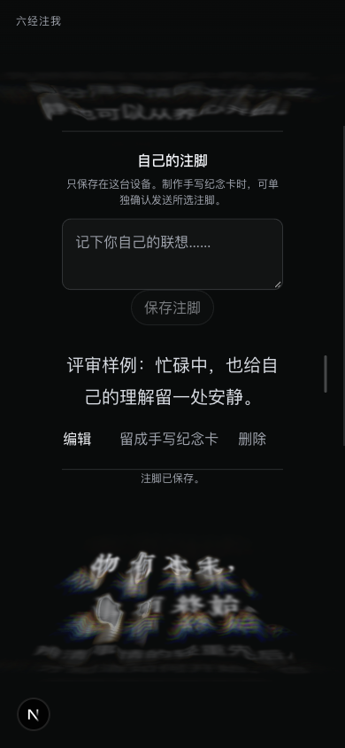
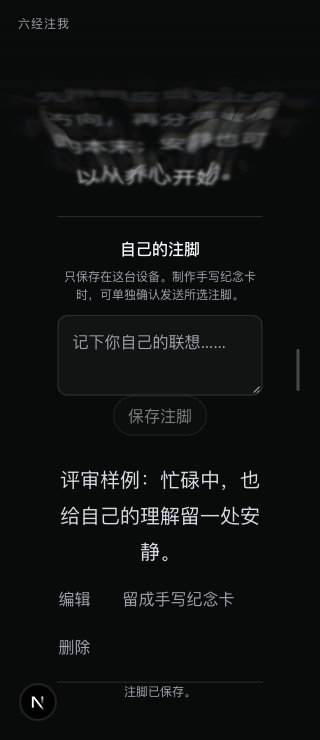
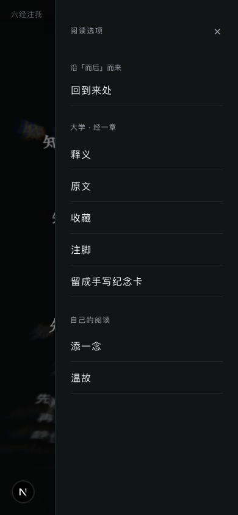

# 六经注我 App 感迭代：实现与复审记录

日期：2026-10-28。范围为本地工作区的已确认方案；本轮未提交、推送或发布公网。

后续交付：用户要求继续迭代并提交、推送；新增菜单问题及真实指针复验结果见[菜单修复与交付](2026-10-28-app-feel-menu-followup.md)。本文保留前一轮记录。

## 本轮改变

| 阅读动作 | 现在的表现 |
| --- | --- |
| 写自己的注脚 | 正文独占阅读列，操作另起一行并可换行；打开时定位并聚焦标题，触屏不强制弹出键盘。 |
| 收藏、取消收藏 | 等待真实存储结果后显示轻反馈。仅本次生效、刷新可能恢复和异常失败分别说明。 |
| 点词接续 | 保留原读点；新首句在主要阅读区之外时提供“已接续 · 去读”，主动进入后定位新经句。 |
| 使用右侧阅读菜单 | 拖动过程中跟手，松开后收束；支持反向、取消、快速重开与键盘进入。经句归属以按下时的光学命中为准。 |
| 从工具返回阅读 | 第一次 Back 关闭当前工具，下一次才返回阅读分支；显式关闭消除空返回层，Forward 不复活旧面板。 |
| 回看较早经句 | 菜单显示该段自身的词／一念来处，并返回该段的父路径；不会误用末端分支的来处。 |

水膜、火彩、康熙经文字体、64% 阅读列、20 / 16 / 12px 与 400 / 500 层级、自动奔流及手动滚动恢复规则保留。核心光学渲染文件及其参数未改动。

## 独立复审

- [lama 独立复审](2026-10-28-app-feel-lama-review.md)：个人阅读路径、动作归属和原生应用的任务循环。
- [Emil 独立复审](2026-10-28-app-feel-emil-review.md)：运动交接、可中断性、焦点与控件细节。

两位独立子 agent 分别读取各自 Skill、确认方案、源码差异及共享证据，分别撰写报告；没有将主线程实测冒充各自操作浏览器。复审发现的问题保留原定级和证据等级，并记录修复后的状态。

本轮修复了复审指出的祖先来处遗漏、取消收藏失败措辞、跨段拖动归属、动画中途接管基线，以及菜单关闭与真实返回同次发生时的重复遍历风险。浏览器补验另发现 Next 的返回处理会异步覆写阅读历史，现由阅读控制器在本路由捕获自己的历史事件；跨路由仍交给框架。

## 验证结果

采用同一 Ego 后台空间、本机固定内容及合成注脚验证；未修改浏览器全局偏好。最终记录中的实际 `/api/flow` 资源请求为 0，未提交付费手写任务。临时浏览器空间和本轮本地服务已关闭，合成注脚已删除。

| 验证 | 结果 |
| --- | --- |
| 相关自动化回归 | 18 套、198 项通过；[摘要](assets/2026-10-28-app-feel/test-summary.json)。 |
| 应用类型、改动文件代码规范、差异空白 | 均通过。 |
| 320 / 390px 注脚 | 正文宽分别 204.80 / 249.59px；编辑、删除均为 44 × 44px，窄屏操作换行。720 字注脚无横向溢出；保存、编辑、取消、删除、撤销已检查。 |
| 桌面注脚交接 | 1450 × 713px 样本标题与输入可见，焦点落在标题。 |
| 屏外接续 | 原读点不移动；主动“去读”定位并聚焦新首句。 |
| 释义、添一念、温故、纪念卡 | 第一次 Back 保持当前分支；下一次返回阅读；Forward 不恢复旧工具。 |
| 三层路径刷新 | 路径及三层历史保留，读点刷新前后均为 906.5px，无存储警告。 |
| 叶节点、祖先来处返回 | 叶节点一次 `go(-2)` 返回直接父级；在末端路径回看祖先，一次 `go(-3)` 回到该祖先的父级，均无额外 `back()`。随后再次接续正常。 |
| 菜单拖动 | 跟手、反向取消、快速重开、纵向不误开与键盘关闭已检查。关闭动画途中按住 180ms 无位置漂移，再拖 40px，误差约 0.0004px。 |

关键记录：[最终边界复验](assets/2026-10-28-app-feel/final-boundary-retest.json)、[分支与历史](assets/2026-10-28-app-feel/branch-and-history-observations.json)、[菜单与工具](assets/2026-10-28-app-feel/gesture-and-panel-observations.json)。早期窄屏记录的按钮曾为 34px，以最终记录的 44px 为准。

## 验证边界

- **打开动画的中途持有样本未捕获到**；关闭方向的有效样本和源码修复不能替代完整开关中断矩阵。
- 首轮刷新受磁盘满、存储不可写影响，已排除该样本；上表刷新结果来自空间恢复后的复验。
- 光学文字的原生指针选择与未变形 DOM 坐标可能不同；祖先来处断言使用实际保存的 `parentEntry`，未把测试预设词当成实际选择。
- 本轮没有完成真机软键盘、Safari／微信、系统读屏、稳定 60 FPS 或几十轮真实模型长读验收，也没有核验两个公网入口。
- 既有依赖文件改动、旧截图目录及此前评审资料保留，未混入本轮产品修改。

## 画面

### 390px 注脚

### 320px 操作换行

### 祖先经句自身的来处

