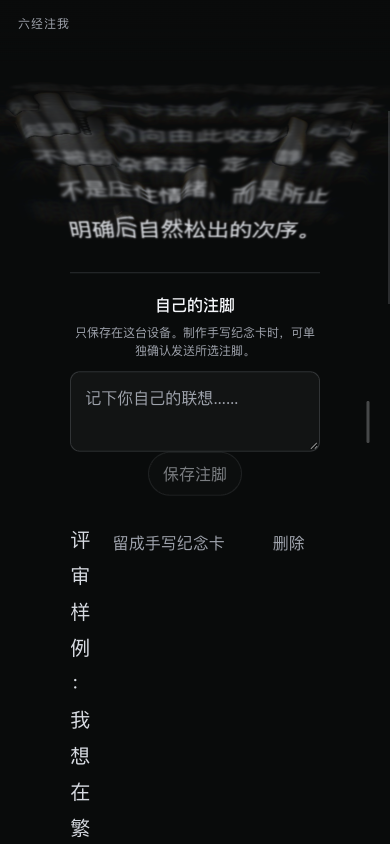

# 六经注我：网页 UI/UX 与连续心流评审

日期：2026-10-28。性质：独立评审与建议汇总，未实施改动。

## 结论

**现有视觉语言与“沿一念进入经典、在同一条文字流中继续探索”的方向一致。优先改善读者采取行动后的交接，以及自己的理解在界面中的位置。**

黑底、康熙经文、中央清晰文字、边缘曲面与水膜，已经形成一个可辨认的阅读场。按需释义、同流点词、保存来路和本机注脚，也具备支撑“六经注我”的结构。

目前最明确的缺陷是：390px 手机视口中，注脚正文被“留成手写纪念卡”和“删除”挤到 **9.59px** 宽，短句变成单字竖列。其次是打开注脚后的焦点和可见位置没有接好；点词成功、面板返回和收藏完成，也缺少足够清楚的结果提示。

持续心流需要读者能主动停下、调整方向、看见回应，并返回刚才的位置。后续优化应先补齐这些动作，再打磨工具层的运动细节。

## 1. 独立评审与证据

| 评审 | Skill 路由 | 侧重 |
| --- | --- | --- |
| [lama 独立报告](2026-10-28-frontend-lama-review.md) | lama → appllama-app-design-skill | 产品层级、导航、移动可用性、“我”的参与及回味 |
| [Emil 独立报告](2026-10-28-frontend-emil-review.md) | emil → emil-design-eng；补充 review-animations | 注意力交接、运动连续性、焦点、手势和可中断性 |

两位子 agent 在隔离上下文中独立阅读设计、源码和共享证据，完成前未阅读对方报告。主线程统一操作后台浏览器、采集证据，再汇总判断。两份报告均明确说明评审员本人没有操作浏览器。

- 现网观察：`https://aitoshuu.me/InfiDao`。
- 运行版本：`infidao-570e028e8b3ee676`；源清单提交 `21526585`。本地源码基准为包含迁移归档的 `4804938`。
- 桌面视口：1450×713。手机仿真：390×844、DPR 2，触摸指针、无 hover。
- 可复核的状态和矩形数据：[observations.json](assets/2026-10-28/observations.json)。
- 共享证据包括阅读、抽屉、稳定释义、真实点词分支、浏览器返回、添一念、注脚、温故和纪念卡草稿。

lama 的原生产品原则用于审视现有网页，没有将 Expo 或原生组件栈作为整改要求。Emil 的动效原则用于判断阅读和工具交接，没有机械地否定持续流动这一核心设计。

## 2. “六经注我”的概念一致性

这里按项目已确认的产品含义审阅：“六经”指向经典阅读，“我”通过一念、选词、停驻、注脚与重访参与。没有把六部书的轮播或书目齐全当作界面要求。

| 读者应得到的体验 | 当前成立的部分 | 需要加强的部分 |
| --- | --- | --- |
| 以自己的兴趣和经验选择方向 | 经文、释义、回响中的词可接续；添一念连接眼前经文 | 首次提示没有清楚解释如何引入一念；自己的注脚不够可达、可读 |
| 在经典与自己的理解间往返 | 可信原文身份、按需释义、完整原文和个人注脚彼此区分 | 出处及生成说明按需隐藏后，首次理解产品的成本提高；可在现有提示和工具层补说明 |
| 知道为什么读到这里 | 数据层保存选择语境、联系和访问路径；温故有“关联” | 抽屉与最近阅读列表难以辨认这一次经过的词或一念 |
| 自主掌握停留和前进 | 点空白可停驻，手动滚动、翻页键可恢复；减少动态效果有实现 | 手动回读也会恢复自动流动，页面没有清楚的播放状态；这是已确认规则的体验取舍 |
| 把有意义的阅读留下来 | 收藏、注脚、温故与主动制作纪念卡形成留存途径 | 收藏后缺可见确认；注脚正文让位于操作按钮；纪念卡的首次选字迹成本较高 |

经文与回响不显示小标题、64% 中央列、输入作为附加交互，都是已有明确决定。相关建议应在这些边界内设计，不恢复正文标签、强制开场问答、阅读回合或图谱画布。

## 3. 优先项：让自己的注脚可读、可达

这张图使用非私人评审样例，样例已通过界面删除。

实际测量：阅读列宽 249.59px，纪念卡按钮 142px，删除按钮 62px，两处间距共 36px，留给注脚正文仅 **9.59px**；样例所在行高约 697px。正文、编辑和操作被放进同一横向 flex 行，是直接原因。

该问题削弱“我”的参与：机器回响可以正常阅读，读者自己写下的理解却无法正常读完。两位评审都将其列为 P1。

另一个交接问题也有直接证据：桌面打开注脚后，输入框顶部为 719.1px，已经超过 713px 视口；焦点仍停在右侧“更多阅读选项”把手。手机样本的输入框可见，但焦点同样没有交给注脚区域。两种情况需分别处理，不能笼统表述为手机输入也一定在屏外。

## 4. 建议顺序

以下是汇总优先级；独立报告保留各自原始定级。After 表示建议，尚未实现或批准为具体交互方案。

| 优先级 | Before | After（建议） | Why |
| --- | --- | --- | --- |
| **P1 · 注脚正文** | 正文和两个操作按钮横排，手机正文仅 9.59px | 正文独占一行，操作放到下一行并可换行；保留20px正文和64%阅读列 | 让读者自己的理解拥有正常阅读空间；见 lama L2、Emil E7 |
| **P1 · 注脚交接** | 打开注脚只改变展开状态，焦点回菜单把手；桌面输入可能在屏下 | 显示注脚标题或输入区域，并按键盘／触屏来源安排焦点；触屏避免强制弹键盘 | 一次动作应能找到自己的下一步；见 lama L2、Emil E2 |
| **P2 · 点词到达** | 点词后保留位置并停驻；新子段在样本中只部分可见，缺少明确到达提示 | 新内容不在主要可读区时，在原选择附近提供安静的“已接续／去读”提示，由读者主动进入 | 连起一念与回应，保留前文和原读点；见 Emil E1 |
| **P2 · 返回层级** | 分支内打开释义后，一次 Back 同时关闭释义并退出分支 | 先确定一致的返回约定；建议先关闭临时任务，再回退阅读来路 | 避免理解一句话时意外跨越两个层级；见 lama L1、Emil E4 |
| **P2 · 初次理解** | “点一下停驻”与“点词接续”容易被理解成冲突；五个手势挤在一句提示里 | 明确“点空白停驻”，按当前情景提示操作，并在现有抽屉交代添一念与注脚的用途 | 降低进入阅读场前的操作解码；见 lama L4 |
| **P2 · 收藏反馈** | 收藏后抽屉关闭；确认仅在读屏状态中，需重新打开验证 | 在阅读场内短暂、安静地显示已收藏／已取消，保留读屏提示 | 减少重复确认和误操作；见 lama L3，源码确认、本轮未实际收藏 |
| **P2 · 回找来路** | 最近阅读主要显示经句、出处、日期；同日重访难辨是哪一次 | 在现有抽屉与温故中按需显示所选词／一念和回到来处动作 | 让持续阅读图成为可理解的个人阅读经历；见 lama L5、Emil E4 |
| **P3 · 工具运动** | 抽屉松手才切换，220ms keyframe 入场，关闭直接隐藏；把手 hover 改高度 | 用可中断的进出状态承接手势，统一关闭过程；把手用 transform 强调并限定精细指针 | 使工具层与连续阅读的空间关系一致；见 Emil E5/E6，仅源码推断，需连续画面复验 |

### 定级分歧与汇总依据

- **返回层级**：lama 列 P1、Emil 列 P2。一次 Back 跨两层已复现；数据没有丢失，关闭按钮和 Esc 可用。汇总列 P2，并把统一返回约定作为设计决定。
- **分支到达**：Emil 列 P1。本次子段从 y=461.1px 延伸到963.1px，桌面高713px，确为部分可见；完全屏外只在较长来源段中构成条件风险。汇总先列 P2，后续用长段复验决定是否升级，不把本例写成“新内容完全不可见”。
- **注脚正文与交接**：独立意见与实测相互支持，作为最先处理的 P1。

## 5. 需要再决定的交互取舍

这些内容不能直接按“修 bug”改写，需先确定具体目标和交互。

1. **手动回读是否仍恢复自动流动。** 当前上滑、下滑、滚轮和翻页键都会恢复自动前移，符合已确认方案。可以保留该默认并补可见状态，也可以让主动回读继续停驻、由明确动作恢复。两种方案都应保留水膜和画质。
2. **“停驻／继续流动”如何表达。** 页面中的“沿此意继续”会取来新经文，“继续补全”恢复未完成生成，滚动则恢复自动位移。应让读者能分清用途；是否增加控制或速度设置需另行设计。
3. **来路与生成解释说明的展示位置。** 优先使用首次提示、现有抽屉、释义和温故；不默认新增常驻导航或恢复已删除标题。
4. **纪念卡作为哪一种收束。** 当前是完整的内容确认、字迹、纸面与异步制作任务。可继续支持主动导出；若希望“留一句”更轻，需要决定预制卡与定制制作的关系、字迹预览来源和默认设置。不能通过自动试写产生额外发送或费用。

## 6. 应保留的设计

- 经文和回响处在同一条文字流中，点词前文仍在，避免频繁换页。
- 康熙经文字体、黑底白光、中央清晰与边缘水膜／火彩的层次。
- 按需释义及其关闭后的播放状态恢复；稳定浮层背景不透明、正文可读。
- 逻辑滚动与物理余量修正，暂停不累计时间；快滚补全字形、慢读保留显现。
- 语义词按钮、焦点词补全、减少动态效果及可读 DOM 回退。
- 温故中的最近阅读、关联、收藏、注脚；个人注脚本机保存，手写制作单独确认。
- 纪念卡按需加载、确认前禁止开始制作，并保留原注脚与导出草稿的区别。

## 7. 后续核对标准与本轮边界

建议先形成注脚排版和焦点交接方案，再处理到达提示、返回约定与低打扰反馈，最后打磨抽屉运动。

后续核对应覆盖：

- 320／390px、桌面和横屏的短长注脚、编辑态、保存与删除撤销，正文不成为单字长列。
- 从当前段、较早段、释义浮层点词；新内容到达可辨认，保留原读点，主动进入后能准确返回。
- 分支内分别打开释义、抽屉、温故、添一念和纪念卡；按决定后的约定逐层返回，前进不出现多余面板。
- 停驻、微滚回读、关闭面板、后台恢复等组合，播放状态可理解；字形显现与水膜规格保持。
- 实体手机的软键盘、系统返回手势与读屏，以及抽屉快速反向操作的连续画面。

本轮完成源码、共享现网页面和有限真实交互的独立审阅。手机是视口与触摸仿真，未模拟软键盘；没有重跑长读、真机、读屏、异常网络或稳定60 FPS验收。运动机制的源码判断不等于已经测得帧率或卡顿。评审截图只保留最终证据，过渡态或错误视口图片已被替换；评审样例注脚已删除，未提交付费手写任务。后台浏览器空间已结束。

本轮交付为本文、两份独立报告及证据文件；没有修改产品实现、提交、推送或发布。后续建议也不构成这些操作的授权。
