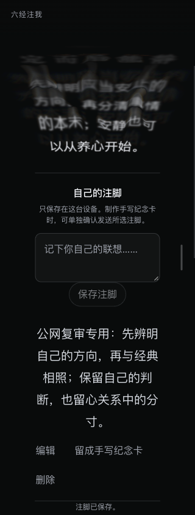
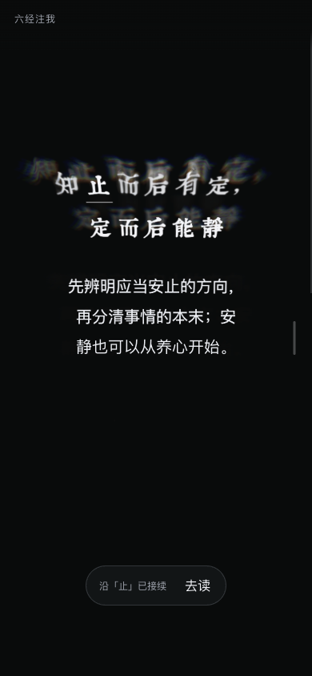
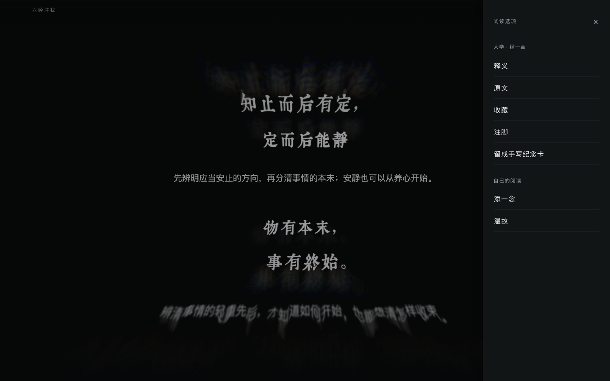

# 腾讯同步与公网 App 感复审

2026-10-28。承接[菜单修复与交付](2026-10-28-app-feel-menu-followup.md)。本轮按用户要求同步腾讯，并复审两个公网入口；沿用 lama 的任务与导航原则、Emil 的交互交接原则，由主线程执行，没有新增独立评审 agent。

## 发布结果

| 项目 | 已核验结果 |
| --- | --- |
| 运行提交 | `9dd9a94f3d5eb9983cc2ffc34c0e54ed4f32ea4c` |
| 腾讯发布目录 | `/opt/infidao-releases/infidao-4d067cad8e780407`，通过 `/opt/infidao-current` 切换 |
| 主入口 | <https://aitoshuu.me/InfiDao>，canonical 保持 `aitoshuu.me` |
| 同步入口 | <https://tongye.me/InfiDao>，URL 与 canonical 均保持 `tongye.me` |
| 运行代码摘要 | `d912147d24521d046ad8a5b97b3724a2b47c6207e0673d5fafc6d7497f34be7f`，两入口相同 |
| 字体版本 | `6260e75c0bc7134351a0`，保留经文字体及 20／16／12px 层级 |
| 存储版本 | 浏览器 4、服务端 1；正式私有环境文件摘要保持一致 |

源码从提交冻结，逐文件核对 685 个输入；源码摘要为 `4d067cad8e78040768d8d517c2e8057d207c9e032e507b9f9d45d1387467bd19`。未把工作区既有的依赖文件改动与旧临时截图混入发布。

腾讯完成 Linux 生产构建、独立候选核验后切换。候选使用独立 Redis 命名空间及零模型额度，以实际服务账户认证 `PING` 得到 `PONG`。切换只重启 Web，Redis 与手写 worker 的 PID 保持不变；原会话、数据及正式每日额度规则延续。阿里继续承担原有 HTTPS 网关，两端配置未改动。

候选及两个公网入口分别通过 **11 个脚本／样式、15 个字体文件、字体清单与 7 个入口／守卫检查**；静态文件与新运行目录逐字节摘要对应。两域同时核对了页面 canonical、版本清单、未认证手写能力读取、私有路径和同域大小写归一。另核验上一版 HTML 引用的 11 个资源仍可读取，支持已打开页面继续使用旧资源。[公网版本与旧资源记录](assets/2026-10-28-tencent-public-app-feel/public-release-compatibility.json)

## 公网实测

使用独立 Ego 后台空间，查看实际截图，覆盖 320／390px 与 1440px、DPR 2。阅读样例来自项目精编 provider，走真实页面、存储及控制器；生成接口受拦截，未发起付费模型或手写制作。

| 场景 | 结果与证据范围 |
| --- | --- |
| 菜单退出遮罩、开关中途抓取、双向停住释放与立即甩动 | **7／7 通过**。真实浏览器命中，鼠标事件 `isTrusted=true`，路径未变化。[记录](assets/2026-10-28-tencent-public-app-feel/public-native-menu-aitoshuu.json) |
| 注脚进入、窄屏排版 | 标题获得焦点；320px 正文宽约 204.8px、20px 字号，操作另起并换行，无整页横向溢出。[几何记录](assets/2026-10-28-tencent-public-app-feel/public-notes-320.json) |
| 注脚完整操作 | 保存、修改、删除、撤销恢复、再次删除通过，最终测试注脚已删除。没有弹出真实手机软键盘的验收结论。 |
| 视觉点词与主动到达 | 从截图确认「止」，以画面坐标点击；提示为“沿「止」已接续”。“去读”将分支标题带入视野并获得焦点。[导航记录](assets/2026-10-28-tencent-public-app-feel/public-reading-navigation.json) |
| 分层返回 | 第一次 Back 关闭菜单并保留分支；第二次回父路径；Forward 返回分支且未重新打开菜单。 |
| 来处、收藏、续读 | 选中分支经句后显示“沿「止」而来”，显式返回正确；收藏与取消分别显示“已收藏”“已取消收藏”；精编连续流由 3 帧接到 6 帧。[记录](assets/2026-10-28-tencent-public-app-feel/public-refresh-continue.json) |
| 刷新 | 分支 URL 与当时 0px 读点保留；未据此宣称非零读点、所有历史恢复组合均通过。 |
| tongye 入口 | 1440px 菜单收束于右边界，宽 300px，无整页横向溢出；390px 原生触摸输入打开菜单，Back 关闭，路径与域名保持。[记录](assets/2026-10-28-tencent-public-app-feel/public-tongye.json) |

上述触摸输入来自浏览器 CDP，记录了可信的 `pointerType=touch` 事件；它不等于物理手机、系统返回手势或软键盘测试。6 帧续读中记录过一次被拦截的 `/api/flow/session` 初始化尝试；未把它写成“所有 API 尝试均为零”。

## 复审意见

### 保留：工具服务于自己的阅读

注脚正文拥有完整阅读列，“我”的联想能与经典并读。点词只给出到达入口，读者决定何时进入；回到来处与分层返回保持方向感。这些交接支持“一念—经句—自己的理解”的关系，也减少工具打断奔流的机会。水膜、经文字体和既有画质延续。

本轮使用精编内容，只能判断交互与表达结构；没有重新评价真实模型对家庭自主边界、几十轮关联性或重复解释的回应质量。

### P3：保存注脚的触控高度仍为 40px

| Before | After（建议） | Why |
| --- | --- | --- |
| 320px 下“保存注脚”为 94×40px；相邻编辑、删除及手写入口高度为 44px。 | 将保存按钮的有效触控高度统一到至少 44px，保留现有外观与阅读列。 | 小屏连续输入后更容易准确确认，触控规则也更一致。 |

这是本轮确认的细节项，尚未修改产品代码。

### 残字观察：短复现未确认持续冻结

初次桌面截图曾捕获到显现尚未完成的文字。随后做一次短复现：在显现中打开菜单，等待约 1.2s 与 2.4s 后，首句均无未完成的墨迹标记，实际画面显示完整。故该单张过渡截图不列为已确认的持续残字故障。[复现记录](assets/2026-10-28-tencent-public-app-feel/public-ink-pause.json)

[FlowStream 的暂停入口](../../src/components/flow/FlowStream.tsx#L450)仍同时暂停位移与墨迹；[InkMotion.pause()](../../src/lib/flow-browser/entrance-motion.ts#L87)保留尚未完成的进度。更早或更晚的中断相位仍有复测价值。本轮没有据一次成功样本排除全部暂停边界，也没有修改逐字显现规则。初次载入截图还曾早于首个可读经句，本轮没有量化冷启动等待时间。

## 交付边界与清理

本轮发布与以上短回归已执行，**稳定 60 FPS、物理手机、软键盘、非零读点的完整恢复及几十轮真实模型长读仍未验收**。不能把 3→6 帧精编续读等同于长期生成质量通过。

候选服务及临时 unit、上传目录、构建依赖与临时 SSH 授权已清理，正式三个服务保持 active；旧发布目录保留用于回滚。没有覆盖或清空 Redis、手写数据库及正式私有配置。回滚代码应沿用当前数据，不应恢复迁移前的旧数据库。

后台浏览器空间已结束。只清理本轮测试路径、对应访问记录与测试注脚，保留共享经文图缓存，没有清空站点存储；保留本报告所需的三张截图，其余本轮临时截图清理。[浏览器清理记录](assets/2026-10-28-tencent-public-app-feel/public-browser-cleanup.json)
